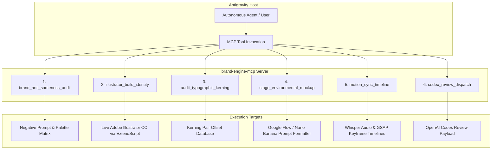

# Phase 05 Context: Brand & Motion Engine MCP Plugin (`brand-engine-mcp`)

## Problem Statement
The user's AI design and animation workflows (spanning Adobe Illustrator CC, After Effects, Google Flow, Magnific, HyperFrames, and Codex) rely on unstructured text prompts and long skill instructions. This introduces several recurring failure modes:

1. **Context Drift & Trope Collapse:** In long multi-turn sessions, LLMs forget negative constraints and collapse into category clichés (pastel greens for tea, generic neo-grotesque sans-serifs, and floating icons glued to wordmarks).
2. **ExtendScript Syntax & Layer Inconsistencies:** Hand-generating hundreds of lines of raw AppleScript/ExtendScript per turn consumes massive context tokens and occasionally misaligns layer names (`Wordmark (Hero)` vs. `Secondary Seals`).
3. **Manual Audio-to-Motion Choreography:** Calculating kinetic typography frames, Whisper word offsets, and GSAP/HyperFrames easing curves manually in chat is error-prone.
4. **Disjointed Environmental Validation:** Staging product artwork into retail shelf or real-world lighting environments in Google Flow requires manual multi-step prompt assembly.

---

## Solution Architecture: `brand-engine-mcp`
Build, deploy, and register the `brand-engine-mcp` plugin in `~/.gemini/config/plugins/brand-engine-mcp/` as a local Node.js stdio MCP server.

### 1. Toolset Breakdown
* **`brand_anti_sameness_audit`:** Deconstructs any category (e.g., matcha, luxury real estate, crypto, clean beauty), returns banned tropes, suggests authentic historical/material counter-anchors, and generates production negative prompts.
* **`illustrator_build_identity`:** Executes verified headless ExtendScript to open/create unflattened master `.ai` files with the strict 4-tier layer standard (`Wordmark (Hero)`, `Secondary Seals`, `Atmospheric Gradients`, `Dielines`).
* **`audit_typographic_kerning`:** Evaluates string character pairs (e.g. `R-A`, `T-o`, `A-V`) and calculates micro-tracking offsets to eliminate visual gaps.
* **`stage_environmental_mockup`:** Assembles directorial Google Flow / Nano Banana prompt envelopes for testing packaging on retail shelves, under direct noon sunlight, or in moody ambient interiors.
* **`motion_sync_timeline`:** Parses audio tracks, extracts word-level cadence timestamps, and outputs frame-accurate GSAP kinetic typography timelines.
* **`codex_review_dispatch`:** Automates the preparation and dispatch of design critique prompts to OpenAI Codex (`ChatGPT.app`).

### 2. Integration with Existing Stack
* Re-uses existing ExtendScript patterns from `design-automation` and `design-starting-point`.
* Complies with `autonomous-designer-core.md` (Illustrator kept open, Photoshop auto-quit, verbatim copy integrity).
* Plugs directly into `~/.gemini/config/plugins/` with `plugin.json` and `mcp_config.json`.
