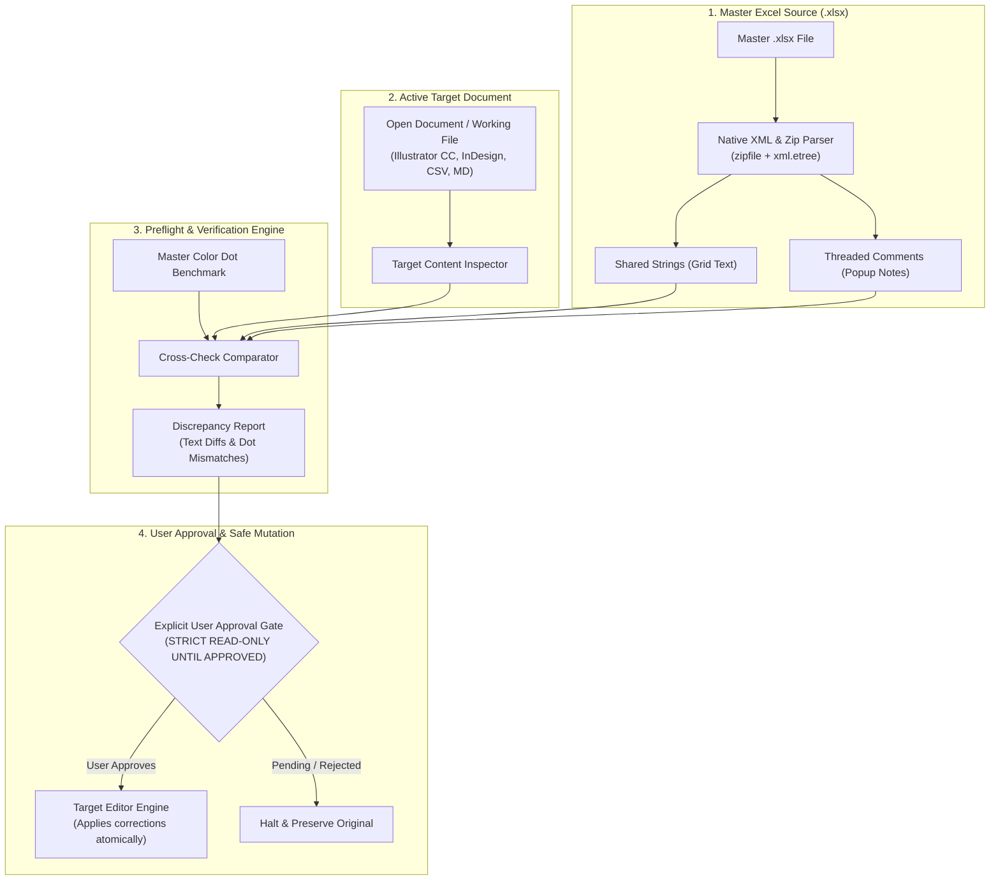

# Phase 07 Context: Excel Master Cross-Check & Threaded Comment Inspector Skill (`excel-doc-crosscheck`)

## 1. Problem Statement & Background
In complex enterprise design and multi-lingual documentation workflows (such as Air France-KLM NDC aggregator matrixes, partner catalogs, and marketing collateral), master datasets are often maintained in modern Excel spreadsheets (`.xlsx`). 

These spreadsheets contain two layers of critical data:
1. **Visible Grid Cells:** Text values (e.g. English feature names in Column A, French translations in Column B).
2. **Hidden Threaded Comments (`xl/threadedComments/threadedComment*.xml`):** Modern Office 365 threaded conversation comments attached to specific cells by contributors (e.g. detailed feature descriptions, implementation caveats, and editorial instructions by authors like Joop van de Ven).

When designers and developers translate, format, or typeset these tables into production files (such as Adobe Illustrator artboards, Adobe InDesign publications, web tables, or markdown documents), several high-friction problems emerge:
- **Missing Hidden Comments:** Conventional CSV exports and standard Python libraries strip out threaded comments, losing the full context/descriptions of features.
- **Silent Typo & Translation Drift:** Text in working documents diverges from the master `.xlsx` without detection.
- **Color Indicator & Dot Misalignment:** Status indicators (e.g. green/pink/purple availability dots) must strictly mirror the master English definition, but get misaligned across languages.
- **Destructive Unverified Edits:** AI agents or automated scripts editing open working files without a preflight review risk corrupting layout layers, text formatting, or typography kerning.

---

## 2. Solution Architecture: `excel-doc-crosscheck`
The `excel-doc-crosscheck` skill encapsulates an end-to-end extraction, verification, and safe-editing pipeline.

---

## 3. Core Requirements & Invariants

1. **Zero-Dependency Native Extraction (`extract_threaded_comments.py`):**
   - Directly unzips `.xlsx` packages in-memory.
   - Parses `xl/worksheets/sheet*.xml` for coordinates, `xl/sharedStrings.xml` for strings, and `xl/threadedComments/threadedComment*.xml` for author comments.
   - Requires only native Python standard library (`zipfile`, `xml.etree.ElementTree`).
   - Exports clean Markdown tables, JSON payloads, or UTF-8-BOM CSVs.

2. **Source-of-Truth Hierarchy:**
   - The master `.xlsx` is the absolute master reference file.
   - Dot color settings and status indicators are identical across languages; the English / master dot settings serve as the benchmark.

3. **Strict Preflight & Approval Workflow:**
   - **Step 1 (Inspection):** Read-only inspection of target document vs. master Excel.
   - **Step 2 (Reporting):** Display side-by-side diffs (Old Text/Color ➔ New Text/Color).
   - **Step 3 (Approval Gate):** Explicit stop point. No changes written until the user confirms.
   - **Step 4 (Atomic Edits):** Apply approved updates with non-destructive verification.
