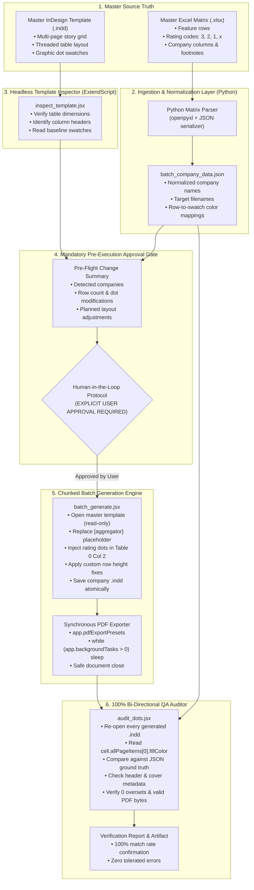

# Phase 08 Context: KLM Aggrea XLSX to InDesign Batch Publisher & QA Auditor Skill (`klm-aggrea-xlsx-to-indesign`)
### Also known as: `klm-aggregator-xlsx-to-indesign` / `xlsx-indesign-batch-publisher`

## 1. Problem Statement & Background
In enterprise document publishing (such as the Air France–KLM NDC Aggregator Overview project), client organizations maintain master feature matrixes in multi-sheet Excel workbooks (`.xlsx`). These matrices track dozens of complex capabilities across 20+ partners or aggregators (e.g., Aaron Group, Amadeus, Sabre, Travelport, Travelfusion) in multiple languages (English, French, etc.).

When publishing these matrices into high-fidelity Adobe InDesign (`.indd`) master templates and generating print-ready deliverables, teams face several acute technical and operational hurdles:

1. **Manual Data Entry Bottlenecks & Human Error:**
   * Hand-toggling 76 individual status rating dots (Green / Orange / Grey) across 23 English and 23 French companies requires manual modification of **3,496 graphical table elements**. A single misplaced dot misrepresents a partner's technical capability.
2. **ExtendScript ECMAScript 3 Limitations:**
   * Adobe InDesign's ExtendScript engine is locked to legacy ECMAScript 3 (1999). It lacks native `.xlsx` parsing, modern regex decoders, JSON streaming, and UTF-8 handling. Attempting to parse raw Excel or heavy JSON inside ExtendScript causes memory leaks or silent string corruption.
3. **Asynchronous PDF Export Truncation:**
   * InDesign exports PDFs asynchronously via background tasks (`app.backgroundTasks`). Closing a document or quitting InDesign before background threads finish produces 0-byte or corrupted partial PDF files.
4. **Layout Geometry & Text Overset Shifts:**
   * Multi-lingual text expansion (e.g., French descriptions being 20-30% longer than English) can cause table cells to overflow (`overflows: true`) or push table rows across page boundaries, breaking carefully tuned multi-page grid structures (such as keeping 53 matrix rows on Page 2).
5. **Absence of Ground-Truth Verification:**
   * Teams historically lacked an automated, bi-directional QA audit that re-opens every generated `.indd` file, reads the actual fill swatches of cell graphic items, and verifies 100% correspondence with the source Excel file.

---

## 2. Solution Architecture: `xlsx-indesign-batch-publisher`

The `xlsx-indesign-batch-publisher` skill packages the battle-tested architecture proven in the Air France–KLM November 2026 batch execution into a reusable, self-contained Antigravity skill.

---

## 3. Core Requirements & Invariants

1. **Strict Human-in-the-Loop Protocol (MANDATORY):**
   * The skill **NEVER** mutates files on disk, generates `.indd` files, or exports PDFs without first summarizing the exact planned scope and waiting for explicit user confirmation.
2. **Deterministic Rating Dot Swatch Mapping:**
   * `3` $\rightarrow$ `Green RGB` (Available / Oui)
   * `2` $\rightarrow$ `Orange RGB` (Work in progress / En cours)
   * `1`, `x`, blank $\rightarrow$ `Grey RGB` (Unavailable / Non)
3. **Synchronous PDF Export Protection:**
   * InDesign exports PDFs in background threads. Scripts must always poll `while (app.backgroundTasks.length > 0) { $.sleep(250); }` before closing the active document.
4. **Chunked Execution Safety:**
   * Processing 20+ heavy multi-page InDesign files in a single turn risks memory bloat. The engine processes in configurable chunks (default: 10–12 companies per chunk) with atomic document closing.
5. **100% Bi-Directional Verification Guarantee:**
   * Every batch generation is followed by an automated audit loop that validates all dots ($N \times \text{rows}$) with zero tolerated mismatches.
