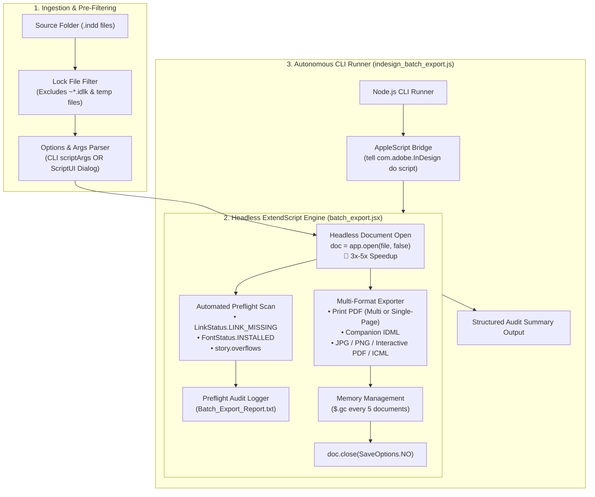

# Phase 09 Context: Automated InDesign Batch Export & Preflight Engine (`indesign-batch-export`)

## 1. Problem Statement & Background
In high-volume editorial and premedia workflows (such as corporate catalogs, localized marketing brochures, and multi-version client publications), production teams must export dozens or hundreds of Adobe InDesign documents (`.indd`) into various deliverable formats (Print PDF, Web PDF, IDML archive packages, JPG previews, PNG graphics, or ICML stories).

Historically, executing these batch exports has introduced multiple operational friction points and technical vulnerabilities:

1. **Severe UI Rendering Overhead (3x–5x Speed Penalty):**
   - Standard ExtendScript scripts and manual UI batch operations open documents into active application windows (`app.open(file)`).
   - InDesign renders all spreads, calculates layout geometries, executes live font rasterization, and displays document windows. For a batch of 50 multi-page documents, UI overhead accounts for 60–80% of total elapsed time.
2. **Silent Preflight Failures in Production Output:**
   - Production PDFs are frequently exported with missing links (`LinkStatus.LINK_MISSING`), missing or substituted fonts (`FontStatus.NOT_INSTALLED`), and uninspected overset text stories (`story.overflows == true`).
   - Designers typically only notice truncated text or low-res placeholder images after deliverables have already been sent to client review or the commercial press.
3. **Session Amnesia (Missing Settings Persistence):**
   - InDesign scripts reset dialog fields upon restart. Operators repeatedly re-navigate nested directory trees, re-select PDF export presets (e.g., `[Press Quality]`), and re-type naming suffixes across daily runs.
4. **Manual Archival Overhead (Missing Companion IDML):**
   - Best-practice agency archiving requires preserving an InDesign Markup Language (`.idml`) file alongside every PDF deliverable. Operators had to run batch export twice—once for PDF, once for IDML—doubling total processing time.
5. **Premedia Imposition Constraints (Single-Page PDF Needs):**
   - Commercial print impositions and proofing portals require single-page zero-padded PDFs (e.g. `Brochure_p001.pdf`, `Brochure_p002.pdf`) rather than monolithic multi-page files.
6. **ExtendScript Memory Leaks & Lock File Collisions:**
   - When processing large volumes of complex documents, InDesign's legacy ECMAScript 3 engine exhausts available heap memory, resulting in sluggishness or outright application crashes. Furthermore, attempting to open active InDesign lock files (`~*.idlk`) throws fatal execution errors.

---

## 2. Solution Architecture: `indesign-batch-export`

The `indesign-batch-export` skill provides an automated, dual-mode (ScriptUI interactive dialog + headless CLI) automation framework.

---

## 3. Core Requirements & Invariants

1. **Headless Execution Priority:**
   - Every document open operation must strictly pass `false` as the second parameter (`app.open(file, false)`), suppressing window creation and UI redraws for maximum throughput.
2. **Mandatory Preflight Audit Trail:**
   - Every document processed must be preflighted for missing links, uninstalled fonts, and overset text stories.
   - All warnings and errors must be aggregated into an autonomous report: `Batch_Export_Report.txt`.
3. **Settings Persistence:**
   - Using InDesign's persistent `app.insertLabel` and `app.extractLabel`, all user selections (folders, format, preset, resolution, flags) must survive application restarts.
4. **Single-Page Zero-Padded PDF Imposition:**
   - When `--single-pages` is enabled, the export engine iterates through `doc.pages`, zero-pads page names to 3 digits (e.g. `_p001.pdf`), and exports distinct PDF files without corrupting document page ranges.
5. **Zero-Lock File Collisions & Periodic Garbage Collection:**
   - Files starting with `~` or ending with `.idlk` must be filtered out immediately.
   - `$.gc()` must be invoked periodically to stabilize InDesign's heap memory during massive batch runs.
