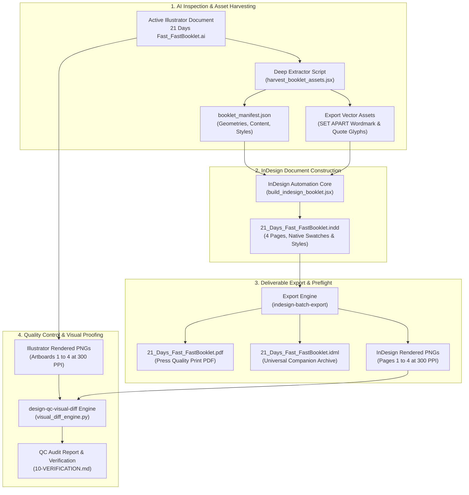

# Phase 10 Context: Illustrator to InDesign 4-Page Booklet Conversion & Automated QC Engine (`illustrator-to-indesign-booklet`)

## 1. Problem Statement & Scope
The user has an active, unflattened Adobe Illustrator document open:  
**`21 Days Fast_FastBooklet.ai`** located at `/Users/admin/Desktop/21 Days Fast_FastBooklet.ai`.

The objective is to execute an automated design AI workflow to:
1. **Extract and Convert:** Convert all 4 artboards/pages from Adobe Illustrator CC into an editable, professional Adobe InDesign CC document (`.indd`) and companion `.idml` / `.pdf` saved directly to `/Users/admin/Desktop/`.
2. **Recreate All 4 Pages with Complete Editorial Fidelity:**
   - **Page 1 (Cover / Intro):** "PATRIA FAMILY FAST", Display Title "Hey Family", body intro, 5-part Table of Contents ("01 What to expect", "01 The definition of fasting", "02 Different types of fasts", "03 Four simple steps on how to fast", "04 Foods to eat and avoid", "05 A Scripture and prayer focus for all 21 days"), decorative dividers, cobalt accent square, and running footer.
   - **Page 2 (Blessing & Dedication):** Full-bleed dark theme (black background), "A BLESSING FOR YOU", scripture blessing ("The Lord bless you and keep you...", NUMBERS 6:24–26), editorial display quotation mark graphics, sign-off ("We love you.", "Team Patria"), and running footer.
   - **Page 3 (Framework & Weekly Guide):** "THIS YEAR’S FAST", master display wordmark "SET APART", "ROMANS 12:2", scripture quote with vertical cobalt accent bar, introductory text, and 3-column structured weekly breakdown (Week 1: Surrender, Week 2: Renewal, Week 3: Obedience), horizontal divider, and running footer.
   - **Page 4 (Teaching Part One):** "Part One", Section Title "The Definition of Fasting", opening teaching paragraph, scripture callout block ("When you give up eating, don’t put on a sad face like the hypocrites..."), decorative quotation marks, closing teaching paragraph, and running footer.
3. **Execute Comprehensive Quality Control (QC):**
   - Zero missing or substituted fonts (`doc.fonts.everyItem().status === FontStatus.INSTALLED`).
   - Zero overset text frames (`story.overflows === false`).
   - Zero broken links (`doc.links.everyItem().status === LinkStatus.NORMAL`).
   - Visual Difference Verification: Run `visual_diff_engine.py` (from `~/.gemini/config/skills/design-qc-visual-diff/`) comparing rendered artboards from Illustrator with rendered pages from InDesign.
   - Fix copy-paste page number anomalies identified in the original AI file (Page 2 footer stating "01" and Page 4 footer stating "03", standardizing to sequential folios "01", "02", "03", "04").

---

## 2. Technical Asset & Font Inventory

### Document Geometry
- **Page Dimensions:** US Letter (612.0 pt × 792.0 pt | 8.5 in × 11.0 in | 215.9 mm × 279.4 mm).
- **Margins:** Top: 64.96 pt (0.90 in), Bottom: 67.87 pt (0.94 in), Left/Inside: 73.09 pt (1.01 in), Right/Outside: 73.09 pt (1.01 in).
- **Live Text Frames:** 48 frames distributed across 4 artboards.
- **Vector Paths & Guides:** 26 path items (divider rules, accent dot, vertical quote bars, background frames, quotation mark shapes).

### Typographic Hierarchy
| Role | Typeface / Style | Size | Leading / Color |
| :--- | :--- | :--- | :--- |
| **Hero Title** | `Cormorant Garamond Light Italic` | 90.2 pt | Auto, Primary Dark |
| **Section Header** | `Cormorant Garamond Light Italic` | 40.2 pt | Auto, Primary Dark |
| **Sign-off Display** | `Cormorant Garamond Light Italic` | 57.5 pt | Auto, White / Light |
| **Scripture Callout** | `Cormorant Garamond Light Italic` | 25.0–26.0 pt | 32 pt, Primary Dark / Light |
| **Display Wordmark** | `Finico Bold / Bold Italic` (Vector) | 92.7–129.2 pt | Native Vector Artwork |
| **Kicker / Label** | `CoFo Sans VF Medium` | 10.8 pt | All-Caps, 120 Tracking |
| **Body Text** | `CoFo Sans VF Regular` | 12.0 pt | 16.5 pt Leading, Primary Dark |
| **Column Kicker** | `CoFo Sans VF Medium` | 8.1 pt | All-Caps, Tracking |
| **Running Folio** | `CoFo Sans VF Regular` | 7.0 pt | All-Caps, Letterspaced |

### Color Palette (CMYK Swatches)
- **Cobalt Accent:** `CMYK(86, 74, 0, 0)` (`#2C4E9C`)
- **Primary Dark / Charcoal:** `CMYK(75, 68, 67, 90)` (`#1A1A1A`)
- **Dark Quote Fill:** `CMYK(95, 86, 48, 62)`
- **Light Quote Fill:** `CMYK(50, 31, 0, 0)`
- **Solid Black (Page 2 BG):** `Process Black` / `Gray(0)`
- **Paper / White:** `[Paper]`

---

## 3. Workflow Architecture

