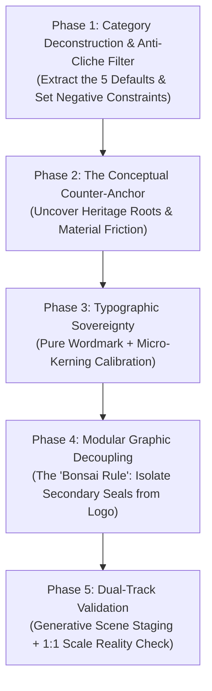

# Anti-Sameness Branding Skill (`/anti-sameness-branding`)

Based on Shantanu Kumar's *Mirai Matcha* brand design methodology (*"How to design a brand that doesn't suck"*), this skill enforces deliberate category differentiation across brand strategy, typographic identity, Illustrator layer structuring, generative AI asset staging, and physical testing.

---

## 1. Core Philosophy: Distinctiveness > Generic Competence

When prompted for an industry niche, generative AI and human designers naturally drift toward the statistical category average (the **"Sea of Sameness"**):
* **Clean Beauty / Wellness:** Pastel blush, minimalist neo-grotesque sans-serif, organic line art leaves, words like *"pure"*, *"radiant"*, *"clean"*.
* **Matcha / Tea:** Sage green, off-white, bamboo or whisk motifs, serif script accents, words like *"zen"*, *"ritual"*, *"ceremonial"*.
* **Luxury Real Estate:** Gold foil, navy blue, ultra-thin Didone serifs, key/palace crests, words like *"exclusive"*, *"prestigious"*.
* **Tech / SaaS:** Indigo-to-violet gradient, Inter typography, glowing glass spheres, dark mode cards.

**The Golden Rule:** Looking clean and professional is the baseline. The core objective of this skill is to **make the brand feel immediately distinct and memorable**.

---

## 2. The 5-Phase Execution Pipeline



---

## Phase 1: Category Deconstruction & Anti-Cliche Filter

Before touching Illustrator or writing generative image prompts, define the **Category Default Matrix**:

1. **Category Color Tropes:** List the top 2-3 colors 90% of competitors use. (Explicitly forbid them as dominant primary tones).
2. **Category Typography Tropes:** List the default font class. If the category is saturated with geometric sans-serif, steer into weighted serifs with modern brackets, or vice versa.
3. **Category Icon Tropes:** List the cliché symbols (leaves, tea bowls, skyline outlines, shield crests). Explicitly prohibit them from appearing anywhere near the primary logo.
4. **Category Copy Tropes:** Identify overused buzzwords and exclude them from headlines and packaging copy.

### Automated Negative Prompt Generator:
When triggering AI image models (`banana-pro-director-30`, `google-flow`, `magnific`):
```text
Negative prompt: generic category tropes, [insert category color, e.g. pastel sage green], bland flat corporate branding, predictable [insert cliché icon, e.g. leaf/zen circle], sterile minimalist sans-serif, generic stock mockups, washed-out beige aesthetic.
```

---

## Phase 2: The Conceptual Counter-Anchor

Great brands find an authentic historical, material, or philosophical truth that competitors overlook.

* **Origin over Cliché:** In *Mirai*, rather than leaning into Kyoto tea houses, the brand recognized matcha's ancient roots in China, unlocking **deep imperial maroon** as the core heritage color.
* **Tactile Material Friction:** Contrast traditional roots with modern industrial finishes:
  * Heritage pigment (e.g., cinnabar maroon, cobalt, deep oxblood) paired with **liquid chrome**, **brushed aluminum**, or **refractive optical glass**.
  * Organic subject matter paired with sharp, architectural shadows and directional lighting.

---

## Phase 3: Typographic Sovereignty (Pure Wordmark)

The primary brand identity is **100% typographic**. Never glue an icon to the logo text.

1. **Typeface Selection:**
   * **Oppose Category Drift:** If DTC/niche brands use neutral sans-serifs, select a grounded, heavy-stemmed display serif with tight brackets and contemporary proportions.
   * **Character & Weight:** The typography must have distinct weight and presence so it does not require an icon crutch.
2. **Micro-Kerning & Optical Tracking Calibration:**
   * Never rely on default font metrics for large display titles or wordmarks.
   * Check tricky character pairs (`R-A`, `T-o`, `A-V`, `P-e`) and calibrate tracking in Illustrator ExtendScript:
     ```javascript
     wordmarkFrame.textRange.characterAttributes.tracking = -20; // Cohesive optical lock
     ```

---

## Phase 4: Modular Graphic Decoupling (The "Bonsai Rule")

A brand's conceptual symbol (like the bonsai tree representing patience and ritual) **must remain a secondary modular asset**.

### Illustrator CC Layer Architecture:
When building master brand artwork in Adobe Illustrator, enforce this clean layer hierarchy:
```text
~/Desktop/<Project Name>/
├── <Project Name>.ai
│   ├── [Layer: Wordmark (Hero)]        --> Standalone primary logotype (100% vector, zero icons)
│   ├── [Layer: Secondary Seals]       --> Modular emblems, stamps, wax seal icons, favicons
│   ├── [Layer: Atmospheric Gradients] --> Diffused shadow gradients, linear transitions
│   ├── [Layer: Packaging Dielines]    --> 1:1 box, tin, bottle, or card dielines
│   └── [Layer: Live Typography]       --> Editable text frames with exact point sizes
```

**Usage Rule:** The secondary emblem lives on packaging sides, envelope stamps, debossed caps, or as an app icon—**never fused into the primary wordmark lockup**.

---

## Phase 5: Dual-Track Environmental Validation

Never finalize a brand identity purely within a 2D digital artboard.

### Track A: Generative AI Environmental Staging
Use `banana-pro-director-30` or `google-flow` to place the brand in real-world environments:
* **The Retail Shelf Test:** Place the product on a grocery, boutique, or pharmacy shelf surrounded by generic competitor products to confirm immediate shelf contrast.
* **The Daylight & Night Test:** Render the product under harsh direct noon sunlight, moody ambient interior lighting, and neon evening light to test material finishes.

### Track B: 1:1 Scale & Physical Reality Check
* Export vector dielines to 1:1 printable scale.
* Print and physically wrap the design around actual cylinders, bottles, or boxes.
* Audit real-world readability:
  * Is the primary wordmark legible from 6 feet away?
  * Does the gradient wrap awkwardly around curved corners?
  * Is secondary ingredient/legal copy compliant and sharp?

---

## 3. Autonomous Codex Critique Protocol (`ask-codex`)

When passing brand artwork to OpenAI Codex via `/ask-codex`, inject this specific evaluation prompt:

> *"Evaluate this brand identity against the Anti-Sameness standard. Analyze: 1) Does it fall into predictable category cliches for its industry? 2) Is the primary wordmark strong enough to stand alone without relying on an icon? 3) Is the secondary graphic emblem properly decoupled? 4) Grade its distinctiveness and memorability on a scale of 1-10 and propose 2 unconventional color/texture pivots."*
