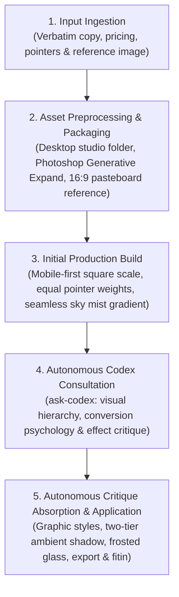

# Autonomous Ad Designer Skill (`/autonomous-ad-designer`)

The `autonomous-ad-designer` skill automates the full lifecycle of luxury advertising creatives across **Adobe Illustrator CC**, **Adobe Photoshop CC**, and **OpenAI Codex** (`ChatGPT.app`).

---

## The 5-Stage Autonomous Pipeline



---

## Stage 1: Ingestion & Verification

1. **Verbatim Content Ingestion**:
   - Transcribe headline, subheadline, price, booking badge, pointers, and call-to-action character-for-character.
   - Never truncate, invent, or alter client copy.
2. **Reference Image Intake**:
   - Measure dimensions, native aspect ratio (e.g. 16:9), color palette, and layout structure.
   - Place reference side-by-side on pasteboard (`left: -1160, top: 1080, width: 1080, height: 607.5`) on dedicated `Reference (Side-by-Side)` layer with **zero outlines, zero borders, and zero text annotations**.

---

## Stage 2: Studio Packaging & Asset Preparation

1. **Standard Studio Packaging Architecture**:
   ```
   ~/Desktop/<Project Name>/
   ├── <Project Name>.ai              # Master root file
   ├── <Project Name> - v1.ai         # Versioned iterations
   ├── Fonts/                         # Project typography (.ttf/.otf)
   ├── Links/                         # Hero, PSDs, reference assets
   └── Output/                        # High-resolution PNGs and JPEGs
   ```
2. **Photoshop Generative Expand**:
   - Pull canvas upward or outward to required aspect ratio (e.g. 1:1 square).
   - Set Fill to Generative Expand with a **strictly blank prompt** (`""`).
   - Upscale to 2160×2160 @ 300 DPI and link into Illustrator full-bleed (`[0, 1080, 1080, 1080]`).

---

## Stage 3: Initial Production Build (User Meta Ads Design Standard)

All designs are built directly against the **User Meta Ads Design Standard** ([`user-meta-ads-design-standard.md`](file:///Users/admin/.gemini/config/rules/user-meta-ads-design-standard.md)), extracted from human master artwork (`Meta Ads Creatives.ai`):

1. **Brand Bar Lockup**:
   - Double logo lockup on top-left (`[Client Logo] | [Developer Logo]`) separated by a $1\text{ pt}$ vertical hairline divider.
   - Precision QR code with circular logo emblem on top-right.
2. **Editorial Didone Headline**:
   - High-contrast luxury editorial serif (**`IvyPrestoDisplay-SemiBold`** $57\text{ pt}$ / $60\text{ pt}$ leading).
   - Paired with **`IvyPrestoDisplay-Italic`** for the emotional anchor word (`RESIDENCE`).
   - Color transition: Deep Navy (`#002644`) on upper daylight sky transitioning to Pure White (`#FFFFFF`) on lower azure sky.
3. **The 2-Tier Floating Price Card (Middle Left)**:
   - Compact $422 \times 139\text{ pt}$ card:
     * Header bar ($h = 66\text{ pt}$, frosted ice cyan): `OWN A FULLY FURNISHED RESIDENCE FROM` in $20\text{ pt}$ `AkmornGrotesque-Bold`.
     * Price tier ($h = 73\text{ pt}$, pure white): `AED 1.65 MILLION` in $37\text{ pt}$ `AkmornGrotesque-Bold`.
4. **The Unified 6-Pointer Matrix Card (Bottom Center)**:
   - **One single wide frosted card** ($858 \times 176\text{ pt}$) centered horizontally.
   - 3 columns × 2 rows with vertical accent bars (`|`) preceding each pointer in $20\text{ pt}$ `AkmornGrotesque-Bold`.
   - `PAY ONLY 30% TO BOOK YOUR UNIT` integrated as Item #2 of Column 1 (never a detached floating pill).
   - Real native live drop shadow ($Y = 6\text{ pt}$, Blur $16\text{ pt}$, Multiply). Zero duplicate opacity paths.
5. **Border-Free Floating CTA**:
   - Pure typography centered over pool water: `GET THE PRICE LIST` in $36\text{ pt}$ `AkmornGrotesque-Black` (wide tracking, pure white).
   - **Zero button boxes, zero stroke borders**. Let the typography float naturally.

---

## Stage 4: Autonomous Codex Consultation (`ask-codex`)

The agent automatically queries OpenAI Codex in the macOS ChatGPT desktop app using `ask_codex.js`:

```bash
node /Users/admin/.gemini/config/skills/ask-codex/scripts/ask_codex.js \
  --product "luxury-ad-designer" \
  --prompt "Evaluate this luxury real estate ad layout. How can we improve visual hierarchy, emotional resonance, and conversion?" \
  --file "<path/to/rebuild_script.jsx>"
```

### Automated Extraction:
- Queries SQLite thread history (`~/.codex/thread_history_1.sqlite`).
- Extracts actionable critique on sequence of attention, typography contrast, and luxury material treatments.
- Saves findings to `codex-ad-improvement-critique.md`.

---

## Stage 5: Critique Absorption & Effect Application

1. **Restrained Luxury Appearance (Codex Standard)**:
   - **Two-Tier Ambient Shadow**: Multiply feel, dark desaturated teal/navy (`#062D42`), 12–15% opacity, $X=0$, $Y=6\text{ pt}$, blur $14\text{ pt}$.
   - **True Frosted Glass (Glassmorphism)**: Background duplicate blurred 12 pt, clipped to panel path, with 92% translucent white fill and 1.2 pt frosted border (`#DCF2FC`).
   - **Specular Edge Sheen**: 1.2 pt white top-lip stroke (75% opacity) simulating physical glass light reflection.
   - **Pure Vector Glyphs**: Never rely on Unicode characters (e.g. `★` or `→`) in text frames; draw pure scale-independent vector paths.
2. **Execution & Live Refresh**:
   - Execute ExtendScript in active Illustrator document via AppleScript.
   - Run `app.executeMenuCommand("fitin")` and `app.redraw()` so the artboard is perfectly framed on screen.
   - Export high-resolution PNG (`300 DPI`) and production JPEG to `Output/`.
   - Update master `<Project Name>.ai` in the project root.

---

## Universal Menu Automation Controller (`illustrator_menu_controller.js`)

The pipeline includes full programmatic control over all 10 menu bar tabs (File, Edit, Object, Type, Select, Effect, View, Window, Help) via `scripts/illustrator_menu_controller.js`:

```javascript
const { executeFastCommand, clickMenuItemPath, executeDOMScript } = require('./scripts/illustrator_menu_controller');

// Fast native menu execution
executeFastCommand('outline');       // Type > Create Outlines
executeFastCommand('expandStyle');   // Object > Expand Appearance
executeFastCommand('dropShadow');    // Effect > Stylize > Drop Shadow
executeFastCommand('sameFill');      // Select > Same > Fill Color
executeFastCommand('fitin');         // View > Fit Artboard in Window

// UI path navigation for complex submenus
clickMenuItemPath('Effect > Stylize > Drop Shadow...');

// Full DOM script execution
executeDOMScript('app.activeDocument.pathItems.length');
```

Full mapping specification is located in [`references/MENU_AUTOMATION_SPEC.md`](file:///Users/admin/.gemini/config/skills/autonomous-ad-designer/references/MENU_AUTOMATION_SPEC.md).
