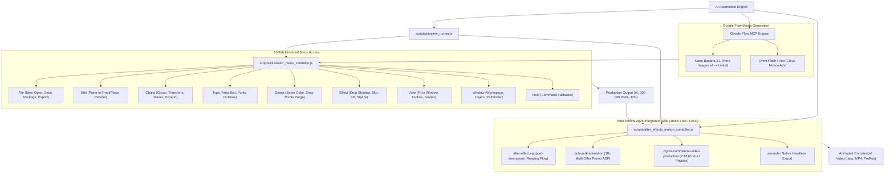

# Design Automation Workflow (`/design-automation`)

The `design-automation` skill provides an end-to-end programmatic automation pipeline for Adobe Illustrator CC, connecting all 10 menu bar tabs into executable JavaScript DOM scripts and native menu commands.

---

## Architecture Overview



---

## 5-Stage Autonomous Execution Pipeline

### Stage 1: Studio Package Setup
Prepares standard project directory architecture on Desktop:
```
~/Desktop/<Project Name>/
├── <Project Name>.ai              # Master Illustrator document
├── Links/                         # Hero rasters, PSDs, reference assets (Google Flow Nano Banana 2.1)
├── Fonts/                         # Project typefaces (.otf / .ttf)
└── Output/                        # Production deliverables (PNG, JPG, PDF, Google Flow video renders)
```

### Stage 1.5: 4-Tier Multimodal Asset Routing (Zero API Cost / PRO Optimized)
> [!IMPORTANT]
> **Strict Generation Pipeline**: In this design automation workflow, all modalities route strictly through verified, zero-cost / optimized engines:
> 1. **Text Copywriting & Hooks (100% Free Tier)**: Routed to Google AI Studio `gemini-3-flash-preview` via `multimodal_router.js`. Instant real estate copy, headlines, and call-to-actions at **$0.00** API cost.
> 2. **Audio Narration & Voiceovers (100% Free Tier)**: Routed to Google AI Studio `gemini-2.5-flash-preview-tts` via `multimodal_router.js`. Generates broadcast 24kHz PCM WAV voiceovers (`Aoede`, `Puck`, `Charon`) at **$0.00** API cost.
> 3. **Image Generation (Google Flow PRO Membership)**: Routed to Google Flow MCP `🍌 Nano Banana 2.1` producing `x4` variants by default. Enforces anti-plastic biological skin fidelity, subsurface scattering, pore realism, and optical lens emulation. Prompts user for aspect ratio (`1:1` for square feeds, `16:9` for landscape banners, `9:16` for vertical ads/stories). Downloads directly to `Links/` and links to the Illustrator artboard using existing PRO subscription credits.
> 4. **Video Generation & Motion (Google Flow PRO Membership)**: Routed strictly to Google Flow MCP `Omni 1.2 Flash` to animate static artboards or luxury plates into 10-second cinematic video ads with camera movement controls (`pan_left`, `pan_right`, `zoom_in`, `tilt_up`, `static`). Outputs save directly to `Output/` using existing PRO subscription credits.
> - **Zero Generic Fallbacks**: Never routes to generic cloud Imagen or unverified third-party models during design automation tasks.

### Stage 2: Canvas Health Audit
- Scans active document via DOM.
- Reports dimensions (e.g. 1080×1080 pt), color profile (RGB/CMYK), total page item count, and full layer hierarchy.

### Stage 3: Autonomous Vector First Aid
- Automatically deletes empty layers.
- Sweeps and purges 0-length unpainted stray anchor points.
- Removes whitespace-only text frames.

### Stage 4: Live Canvas Framing
- Fires `View > Fit Artboard in Window` (`Cmd + 0`) via `executeFastCommand('fitin')` so the artboard is centered cleanly on the user's screen.

### Stage 4.5: User Approval Checkpoint (MANDATORY RULE)
> [!IMPORTANT]
> **Strict Export Gate**: Unless the user explicitly reviews and approves the design, DO NOT export final production outputs (PNG, JPG, PDF) unless specifically instructed. Always stop after Stage 4, display the live canvas and preview, and await explicit user sign-off.

### Stage 5: Gated Production Export (Only Upon User Approval)
- Triggered strictly after user sign-off.
- Silently saves the master `.ai` file without modal dialog interruptions (`UserInteractionLevel.DONTDISPLAYALERTS`).
- Exports 300 DPI anti-aliased PNG-24 with artboard clipping.
- Exports high-quality production JPEG and interactive web PDF.

### Stage 6: After Effects Motion Graphics & Video Pipeline (100% Free / Local Engine)
> [!NOTE]
> Replaces or supplements cloud video models with native ExtendScript automation in **Adobe After Effects 2026**:
- **Reading-Flow Puppet Animations**: Integrates `after-effects-puppet-animations` to sequence multi-layer vector layouts with kinetic ease curves and anchor point normalization.
- **10-Second Promo Comps**: Integrates `pub-perk-animation` (`build_ae_animation.jsx`) to turn multi-offer `.ai` files into animated `.aep` packages.
- **9:16 Vertical Commercial Ads**: Integrates `zigma-commercial-video-production` with floating buoyancy physics expressions and 3D badge callouts.
- **Headless Render**: Exports via `/Applications/Adobe After Effects 2026/aerender` directly to `Output/`.

---

## CLI Usage

### Run Full Pipeline
```bash
node /Users/admin/.gemini/config/skills/design-automation/scripts/pipeline_runner.js --action all --project "<Project Name>"
```

### Run Specific Action
```bash
# Audit document health
node /Users/admin/.gemini/config/skills/design-automation/scripts/pipeline_runner.js --action audit

# Run Vector First Aid cleanup
node /Users/admin/.gemini/config/skills/design-automation/scripts/pipeline_runner.js --action cleanup

# Fit artboard to window
node /Users/admin/.gemini/config/skills/design-automation/scripts/pipeline_runner.js --action fit

# Export production PNG & JPG
node /Users/admin/.gemini/config/skills/design-automation/scripts/pipeline_runner.js --action export

# Check After Effects integration health
node /Users/admin/.gemini/config/skills/design-automation/scripts/pipeline_runner.js --action ae-status

# Generate After Effects animation (.aep) from active project
node /Users/admin/.gemini/config/skills/design-automation/scripts/pipeline_runner.js --action animate --ae-mode puppet --flow columns --duration 10

# Generate Expression-Driven Kinetic AI Video Showcase (Zero Keyframe Clutter)
osascript -e 'tell application "Adobe After Effects 2026" to DoScriptFile "/Users/admin/.gemini/config/skills/design-automation/scripts/build_kinetic_showcase.jsx"'
```

---

## Universal Menu Controller (`illustrator_menu_controller.js`)

Provides direct programmatic execution from Node.js or shell:

```javascript
const { executeFastCommand, clickMenuItemPath, executeDOMScript } = require('./scripts/illustrator_menu_controller');

// Fast native menu execution
executeFastCommand('outline');       // Type > Create Outlines
executeFastCommand('expandStyle');   // Object > Expand Appearance
executeFastCommand('dropShadow');    // Effect > Stylize > Drop Shadow
executeFastCommand('sameFill');      // Select > Same > Fill Color
executeFastCommand('fitin');         // View > Fit Artboard in Window

// UI path navigation for complex submenus
clickMenuItemPath('Effect > Stylize > Drop Shadow...');

// Direct DOM scripting (with automatic Escape tool-dismissal & silent alerts)
executeDOMScript('app.activeDocument.pathItems.length');
```

---

## Reference Documents
- **Tab-by-Tab Automation Specification**: [`references/MENU_AUTOMATION_SPEC.md`](file:///Users/admin/.gemini/config/skills/design-automation/references/MENU_AUTOMATION_SPEC.md)
- **Complete Illustrator Menu Bar Guide**: [`references/ILLUSTRATOR_MENU_BAR_GUIDE.md`](file:///Users/admin/.gemini/config/skills/design-automation/references/ILLUSTRATOR_MENU_BAR_GUIDE.md)
- **AI Automation Architecture Guide**: [`references/AI_ILLUSTRATOR_AUTOMATION_GUIDE.md`](file:///Users/admin/.gemini/config/skills/design-automation/references/AI_ILLUSTRATOR_AUTOMATION_GUIDE.md)
- **Zero-Keyframe After Effects Expressions Guide**: [`references/EXPRESSIONS_REFERENCE.md`](file:///Users/admin/.gemini/config/skills/design-automation/references/EXPRESSIONS_REFERENCE.md)
