# Design Automation Workflow (`/design-automation`)

The `design-automation` skill provides an end-to-end programmatic automation pipeline for Adobe Illustrator CC, connecting all 10 menu bar tabs into executable JavaScript DOM scripts and native menu commands.

---

## Architecture Overview

```mermaid
flowchart TD
    A["AI Automation Engine"] --> B["scripts/pipeline_runner.js"]
    A --> GF["Google Flow MCP Engine"]
    A --> PS["scripts/photoshop_mars_controller.js (Mars Premedia Engine)"]
    A --> AE["scripts/after_effects_motion_controller.js"]
    A --> QC["design-qc-visual-diff (Automated QC & Visual Proofing Engine)"]
    
    subgraph FlowGen["Google Flow Media Generation"]
        GF --> GF1["Nano Banana 2.1 (Hero Images x4 -> Links/)"]
        GF --> GF2["Omni Flash / Veo (Cloud Motion Ads)"]
    end

    subgraph MarsPremedia["Mars Premedia Photoshop Automation"]
        PS --> PS1["Auto-Crop Subject/People (9:16 & 16:9 Headroom Centering)"]
        PS --> PS2["Batch Size & Mask (Subject Cutouts + Track Mattes)"]
        PS --> PS3["Layer Slicing & 3D Spatial Manifest for AE"]
        PS --> PS4["Variable CSV Engine (Bulk Video Variations)"]
        PS --> PS5["Media Pre-Flight Audit (RGB Video Engine Check)"]
    end

    subgraph DesignQC["Design QC & Visual Diffing for AI Video"]
        QC --> QC1["Automated Document Audit (Colors, Label/Fill Mismatches, Font Briefs, Typos)"]
        QC --> QC2["Image Mode (Side-by-Side Storyboard & Frame Comparison)"]
        QC --> QC3["Marked Mode (Pixel Diffing, Red Bounding Boxes, Numbered Pins 1..N)"]
        QC --> QC4["On-Canvas Markers ([QC_DIFF_MARKERS] Non-Printing Layer)"]
        QC --> QC5["Interactive HTML Dashboard (Curtain Slider Proofing)"]
    end

    subgraph AEMotion["After Effects 2026 Integrated Skills (100% Free / Local)"]
        AE --> AE1["after-effects-puppet-animations (Reading Flow)"]
        AE --> AE2["pub-perk-animation (10s Multi-Offer Promo AEP)"]
        AE --> AE3["zigma-commercial-video-production (9:16 Product Physics)"]
        AE --> AE4["ae-motion-clone (Universal Reference Video Motion Cloner)"]
        AE --> AE5["ae-comp-to-gif (Harmonic 50/25 FPS Dual-Tier GIFs & Auto MP4 Purge)"]
        AE --> AE6["aerender Native Headless Export"]
    end
    
    B --> C["scripts/illustrator_menu_controller.js"]
    B --> PS
    B --> AE
    B --> QC
    QC --> AE
    
    subgraph MenuExecution["10-Tab Universal Menu Access"]
        C --> M1["File (New, Open, Save, Package, Export)"]
        C --> M2["Edit (Paste in Front/Place, Recolor)"]
        C --> M3["Object (Group, Transform, Masks, Expand)"]
        C --> M4["Type (Area Text, Fonts, Outlines)"]
        C --> M5["Select (Same Color, Stray Points Purge)"]
        C --> M6["Effect (Drop Shadow, Blur, 3D, Stylize)"]
        C --> M7["View (Fit in Window, Outline, Guides)"]
        C --> M8["Window (Workspace, Layers, Pathfinder)"]
        C --> M9["Help (Command Fallbacks)"]
    end

    FlowGen --> PS
    PS --> C
    MenuExecution --> D["Production Output (AI, 300 DPI PNG, JPG)"]
    D --> AE
    PS --> AE
    AEMotion --> E["Animated Commercial Video (.aep, MP4, ProRes)"]
```



---

## 5-Stage Autonomous Execution Pipeline

### Stage 1: Studio Package Setup
Prepares standard project directory architecture on Desktop:
```
~/Desktop/<Project Name>/
├── <Project Name>.ai              # Master Illustrator document
├── Links/                         # Hero rasters, PSDs, reference assets (Google Flow Nano Banana 2.1)
├── Fonts/                         # Project typefaces (.otf / .ttf)
└── Output/                        # Production deliverables (PNG, JPG, PDF, Google Flow video renders)
```

### Stage 1.5: 4-Tier Multimodal Asset Routing (Zero API Cost / PRO Optimized)
> [!IMPORTANT]
> **Strict Generation Pipeline**: In this design automation workflow, all modalities route strictly through verified, zero-cost / optimized engines:
> 1. **Text Copywriting & Hooks (100% Free Tier)**: Routed to Google AI Studio `gemini-3-flash-preview` via `multimodal_router.js`. Instant real estate copy, headlines, and call-to-actions at **$0.00** API cost.
> 2. **Audio Narration & Voiceovers (100% Free Tier)**: Routed to Google AI Studio `gemini-2.5-flash-preview-tts` via `multimodal_router.js`. Generates broadcast 24kHz PCM WAV voiceovers (`Aoede`, `Puck`, `Charon`) at **$0.00** API cost.
> 3. **Image Generation (Google Flow PRO Membership)**: Routed to Google Flow MCP `🍌 Nano Banana 2.1` producing `x4` variants by default. Enforces anti-plastic biological skin fidelity, subsurface scattering, pore realism, and optical lens emulation. Prompts user for aspect ratio (`1:1` for square feeds, `16:9` for landscape banners, `9:16` for vertical ads/stories). Downloads directly to `Links/` and links to the Illustrator artboard using existing PRO subscription credits.
> 4. **Video Generation & Motion (Google Flow PRO Membership)**: Routed strictly to Google Flow MCP `Omni 1.2 Flash` to animate static artboards or luxury plates into 10-second cinematic video ads with camera movement controls (`pan_left`, `pan_right`, `zoom_in`, `tilt_up`, `static`). Outputs save directly to `Output/` using existing PRO subscription credits.
> - **Zero Generic Fallbacks**: Never routes to generic cloud Imagen or unverified third-party models during design automation tasks.

### Stage 1.7: Mars Premedia Photoshop Conditioning & AI Video Pre-Flight Engine
> [!NOTE]
> Integrates **Mars Premedia (William Campbell)** automation patterns to condition raw AI assets into production-grade video and animation plates:
> - **Auto-Crop Subject & People for Video**: Uses Adobe Sensei `selectSubject` (`autoCutout`) to detect subjects, computes center-of-mass and headroom margins, and performs non-destructive crops directly into `9:16` (1080×1920) for mobile Reels/TikTok or `16:9` (1920×1080) for widescreen video models (Omni Flash / Veo).
> - **Batch Size & Mask (Cutout & Track Mattes)**: Automatically isolates subjects into transparent 32-bit PNGs (`_cutout.png`) and high-contrast B&W alpha track mattes (`_mask.png`) required by After Effects for puppet pin rigging and floating buoyancy physics.
> - **Layer Slicing & 3D Spatial Manifest**: Slices multi-layer PSD documents into isolated PNG assets while writing `layers_manifest.json` containing exact pixel bounding boxes, opacities, and blend modes for After Effects 2.5D parallax reconstruction.
> - **Data-Driven Variable Production from CSV**: Dynamically injects rows from spreadsheets to batch-update text layers and swap hero images—generating dozens of localized or personalized graphic plates for high-volume video ads.
> - **Media Pre-Flight Audit (Images Report)**: Scans project media folders, audits pixel dimensions and PPI, and flags/converts CMYK assets to RGB (preventing video render engine corruption).
> - **Before & After Proofing**: Generates side-by-side comparison proofing plates for client showcases and video overlays.

### Stage 1.8: Design QC & Visual Diff Proofing Engine (`design-qc-visual-diff`)
> [!IMPORTANT]
> **Pre-Flight Video Animation Gate & Change Verification**:
> Before rendering animations in After Effects or sending plates to Google Flow, this engine guarantees flawless vector assets and visual change verification:
> 1. **Automated Document Pre-Flight QC (`qc_auditor.jsx`)**:
>    - **Brand Color Integrity**: Detects unauthorized hex codes and flags **Label vs. Fill Mismatches** (e.g. text saying `#C7DCE9` but swatch is `#F1E5BE`).
>    - **Video Color Space Check**: Audits RGB vs CMYK, preventing CMYK assets from corrupting After Effects video renderers (`aerender`).
>    - **Typography & Brief Compliance**: Enforces font rules (e.g. *1 headline font + N body options*), weight distributions, and detects clipped text frames.
>    - **Content & Copy-Paste Residue**: Catches typos (*Dusky* vs *Dusty*, *Cateogary*), placeholder copy (`Lorem Ipsum`, `TBD`), and cross-section copy-paste errors before rendering frames.
>    - **Geometry First Aid**: Purges 0-length stray points and unpainted paths that cause empty layer masks or mesh errors in After Effects puppet rigging.
> 2. **Multi-Mode Visual Change Proofing (`visual_diff_engine.py`)**:
>    - **Image Mode (Side-by-Side)**: Generates high-res Before vs. After artboard composites for storyboard and layout comparisons.
>    - **Marked Mode (Bounding Boxes & Callout Pins)**: Computes pixel deltas, clusters changed areas, and renders vibrant red highlight boxes with numbered pins `[1]`, `[2]`, `[3]` pointing directly to modified copy, swatches, or layout shifts.
>    - **On-Canvas Diff Layer (`[QC_DIFF_MARKERS]`)**: Directly injects non-printing highlight boxes and pins on the live Illustrator canvas for in-app review (`printable = false`).
>    - **Interactive HTML Curtain Slider**: Provides a self-contained split-screen slider dashboard for client/director sign-off before expensive video rendering passes.

### Stage 2: Canvas Health Audit
- Scans active document via DOM.
- Reports dimensions (e.g. 1080×1080 pt), color profile (RGB/CMYK), total page item count, and full layer hierarchy.

### Stage 3: Autonomous Vector First Aid
- Automatically deletes empty layers.
- Sweeps and purges 0-length unpainted stray anchor points.
- Removes whitespace-only text frames.

### Stage 4: Live Canvas Framing
- Fires `View > Fit Artboard in Window` (`Cmd + 0`) via `executeFastCommand('fitin')` so the artboard is centered cleanly on the user's screen.

### Stage 4.5: User Approval Checkpoint (MANDATORY RULE)
> [!IMPORTANT]
> **Strict Export Gate**: Unless the user explicitly reviews and approves the design, DO NOT export final production outputs (PNG, JPG, PDF) unless specifically instructed. Always stop after Stage 4, display the live canvas and preview, and await explicit user sign-off.

### Stage 5: Gated Production Export (Only Upon User Approval)
- Triggered strictly after user sign-off.
- Silently saves the master `.ai` file without modal dialog interruptions (`UserInteractionLevel.DONTDISPLAYALERTS`).
- Exports 300 DPI anti-aliased PNG-24 with artboard clipping.
- Exports high-quality production JPEG and interactive web PDF.

### Stage 6: After Effects Motion Graphics & Video Pipeline (100% Free / Local Engine)
> [!NOTE]
> Replaces or supplements cloud video models with native ExtendScript automation in **Adobe After Effects 2026**:
- **Reference-Driven Motion Cloning (`ae-motion-clone`)**: Clones animation choreography directly from any reference video or web link (Behance, YouTube, Loom, MP4, GIF). Injects 4 physical archetypes: `cascade_drop` (Arôme Bakery style 4-phase lifecycle with air wobble and bounce), `carousel_scroll` (Slide 10 infinite seamless repeating card stream), `elastic_pop`, and `stagger_slide`. Enforces `--elements-only` rule (locks typography & background) and supports `--layout stacked` (middle-filling overlapping collage).
- **Reading-Flow Puppet Animations**: Integrates `after-effects-puppet-animations` to sequence multi-layer vector layouts with kinetic ease curves and anchor point normalization.
- **10-Second Promo Comps**: Integrates `pub-perk-animation` (`build_ae_animation.jsx`) to turn multi-offer `.ai` files into animated `.aep` packages.
- **9:16 Vertical Commercial Ads**: Integrates `zigma-commercial-video-production` with floating buoyancy physics expressions and 3D badge callouts.
- **Dual-Tier Smooth GIF Publisher (`ae-comp-to-gif`)**: Converts any composition into butter-smooth, non-lagging 50/25/20 FPS GIFs with seamless loop protection and two-pass differential palette optimization. Exports directly to `Output/GIFs_High/` (master full-res) and `Output/GIFs_Web/` (1024px web-optimized), and automatically purges intermediate rendered `.mp4` video files.
- **Dynamic 9:16 AI Video Showcase Assembler (`ai_video_controller.js` / `build_ai_video_showcase.jsx`)**: Combines hero AI video footage (from Google Flow or image-to-video), clean 2-keyframe kinetic text overlays, master buoyancy slider controls, voice narration, and SFX whooshes into a complete commercial video ad package.
- **Headless Render**: Exports via `/Applications/Adobe After Effects 2026/aerender` directly to `Output/`.

---

### Stage 7: Zero-Cost Headless Local Shorts Engine
> [!NOTE]
> Automated local short-form video generation running 100% on CPU with **$0 API costs**:
- **Studio AI Voiceover**: Ultra-realistic human speech synthesis powered by Kokoro-82M.
- **Millisecond Kinetic Captions**: Word-by-word synchronized subtitles powered by local Whisper.
- **Procedural Motion**: Automatic 2-second visual rhythm shifts, algorithmic infinite looping, and procedural audio mixing (whooshes, sound effects, background score).

---

### Stage 8: Blender 3D Headless Automation & Volumetric Lighting
> [!NOTE]
> Automated 3D asset generation, scene setup, and camera rigging via `blender-mcp`:
- **Dual-Engine Execution**: Auto-detects live Blender GUI session on `127.0.0.1:9876` or falls back to headless background execution via `blender_run_headless`.
- **Physically-Based Lighting**: Blender 4.x/5.x Principled BSDF socket configurations, EEVEE-Next/Cycles optimization, atmospheric fog, and water caustics.
- **Camera Path Constraints**: Binds camera objects to Bezier curve trajectories for Hollywood crane, dolly, and jib movements.

---

### Stage 9: Unified Google Flow Cinematic Animation Pipeline
> [!IMPORTANT]
> The battle-tested 5-phase production system for generative multi-shot cinematic video inside Google Flow (`flow.google.com`):
1. **Dedicated Character Panel**:
   - Create character in `accessibility_new Characters`.
   - Render portrait headshot variants.
   - Click `[ Create body ]` and enter visual prompts directly in the bottom ProseMirror bar (`Describe body and outfit...`), NOT the left *Character info* textarea.
   - Assign expressive voice model (e.g. `Algenib` male gravelly low pitch).
2. **5-Shot Sequential Scene Plates**:
   - Generate 16:9 widescreen environment plates with `🍌 Nano Banana 2.1` in the Scenes / Media tab: Shot 1 Wide Establishing (35mm), Shot 2 Medium Tracking, Shot 3 Macro Mechanism Insert, Shot 4 Medium Close-Up Reaction, Shot 5 High Crane Climax.
3. **Master Storyboard Blueprint**:
   - Compose unified 5-beat production storyboard visual linking the character dossier with sequential shot timecodes (0–3s, 3–6s, 6–9s, 9–12s, 12–15s), camera kinematics, and timecoded dialogue.
4. **Native `@` Shortcut Ingredient Binding**:
   - In the prompt bar under **Video mode** (`Omni 1.2 Flash · 360p · 15s · 16:9`), type **`@`** to immediately tag `@<Character Name>` and `@<Scene Plates 1..5>` without clicking errors.
   - Inject complete directorial action prompts with speed ramps, water caustics, and dialogue.
5. **Strict Asset Governance**:
   - **Never automatically download generated video or image files to personal `/Users/admin/Downloads`**. Keep all assets active on the live Google Flow canvas unless the user explicitly orders a download.

---

### Stage 10: Integrated Directorial Prompting Architecture
- **`cinema-director-v3`**: 16-slot locked spine for video diffusion simulation.
- **`banana-pro-director-30`**: Theatrical grain, atmospheric perspective, and optical anamorphic scene plates.
- **`character-builder`**: Canonical face locks and 3-panel/6-panel turnaround sheets for zero identity drift.
- **`realistic-image-prompts`**: Organic portrait optics, authentic subsurface scattering, and skin pore realism.

---

### Stage 11: The 1,000 Viral Hooks & Eye-Catching Visual Retention Engine
*Psychological Pattern Interrupts & High-Retention Cinematics for AI Video & Ads*
* 📚 **Source**: `1,000 Viral Hooks Master Archive` (Educational, Storytelling, Myth-Busting, Comparison, Authority, Day-in-the-Life, Curiosity Traps).

#### 1. The 7 Core Viral Hook Formulas
1. **The Asymmetric Value Compression**:
   > *"It took me 10 years to learn this, but I’ll teach it to you in less than 60 seconds."*
   > *Visual*: Rapid countdown clock overlay + high-tempo whip-pan into the master action.
2. **The Stark Polar Comparison**:
   > *"This is what [Subject] looks like when you do [Action] vs. when you don't."*
   > *Visual*: Split-screen or snap-morph comparing dull, stagnant before-state to vibrant, cinematic after-state.
3. **The Loss Aversion / Reverse Psychology Trap**:
   > *"If you want to end up [Pain Point], skip this video."* / *"Do NOT do [Action] if you are [Target Audience]."*
   > *Visual*: Aggressive optical crash-zoom on subject's warning gesture + low sub-bass impact.
4. **The Insider Cheat Code / Unfair Advantage**:
   > *"I think I just found the biggest [Industry/Niche] cheat code."*
   > *Visual*: Macro Dutch-tilt revealing a secret glowing mechanism or unexpected asset.
5. **The Proof of Work / Micro-Demonstration**:
   > *"This represents your [Metric/Subject] before, during, and after [Method]."*
   > *Visual*: 3-stage temporal progression across 0-3s, 3-6s, and 6-9s with fluid particle transitions.
6. **The Unapologetic High-Status Authority**:
   > *"Not to flex, but I'm pretty f*cking good at [Skill]. Here are the only 3 rules you need."*
   > *Visual*: Heroic low-angle pedestal push-in with sharp directional rim lighting.
7. **The Infinite Narrative Loop**:
   > Final line scripts syntactically into opening hook (e.g. End: *"...which is why everyone asks..."* ➔ Start: *"Can you tell us how to [Result] in 60 seconds?"*).

#### 2. Visual Kinematics for 85%+ Viewer Retention
- **First-Frame Eye-Snag (0.0s – 0.8s)**: Never open on a static pose, empty background, or generic greeting. Open at the apex of motion, liquid splash, gear engagement, or dramatic lighting flare.
- **2-Second Visual Reset**: Trigger a camera shift, angle cut, or scale punch (`100% -> 120% snap-zoom`) every 2.0 to 2.5 seconds to reset viewer cognitive attention.
- **Center-Screen Kinetic Captions**: 2–3 words per flash, bold high-contrast grotesque typography (`Montserrat Black` or `Integral CF`), with yellow/cyan active word highlight and subtle sound design sync (pop/ding).
- **Audio Foley Layering**: Every visual cut must pair with a crisp transient (riser buildup, heavy bass drop, hydraulic clunk, or atmospheric whoosh).

---

## CLI Usage

### Run Full Pipeline
```bash
node /Users/admin/.gemini/config/skills/design-automation/scripts/pipeline_runner.js --action all --project "<Project Name>"
```

### Run Specific Action
```bash
# Audit document health
node /Users/admin/.gemini/config/skills/design-automation/scripts/pipeline_runner.js --action audit

# Run Vector First Aid cleanup
node /Users/admin/.gemini/config/skills/design-automation/scripts/pipeline_runner.js --action cleanup

# Fit artboard to window
node /Users/admin/.gemini/config/skills/design-automation/scripts/pipeline_runner.js --action fit

# Export production PNG & JPG
node /Users/admin/.gemini/config/skills/design-automation/scripts/pipeline_runner.js --action export

# Check After Effects integration health
node /Users/admin/.gemini/config/skills/design-automation/scripts/pipeline_runner.js --action ae-status

# Check Photoshop & Mars Premedia integration health
node /Users/admin/.gemini/config/skills/design-automation/scripts/pipeline_runner.js --action ps-status

# Auto-crop assets in Links/ to 9:16 or 16:9 centered on subject for video
node /Users/admin/.gemini/config/skills/design-automation/scripts/pipeline_runner.js --action ps-crop --ratio 9:16

# Generate subject cutouts & alpha track mattes for After Effects
node /Users/admin/.gemini/config/skills/design-automation/scripts/pipeline_runner.js --action ps-mask

# Pre-flight audit media assets for video engine compliance (RGB check, PPI)
node /Users/admin/.gemini/config/skills/design-automation/scripts/pipeline_runner.js --action ps-report

# Slice PSD layers and export spatial manifest for After Effects rigging
node /Users/admin/.gemini/config/skills/design-automation/scripts/pipeline_runner.js --action ps-slice --psd "/path/to/master.psd"

# Batch produce variable graphic plates from CSV data
node /Users/admin/.gemini/config/skills/design-automation/scripts/pipeline_runner.js --action ps-csv --csv "/path/to/data.csv" --psd "/path/to/template.psd"

# Generate After Effects animation (.aep) from active project
node /Users/admin/.gemini/config/skills/design-automation/scripts/pipeline_runner.js --action animate --ae-mode puppet --flow columns --duration 10

# Clone reference animation into AE composition (Arôme style stacked collage)
node /Users/admin/.gemini/config/skills/design-automation/scripts/pipeline_runner.js --action motion-clone --comp "Slide 11" --ref "https://www.behance.net/gallery/234862147/Arome-Visual-Identity-Bakery-Branding/modules/1349053657" --archetype cascade_drop --layout stacked --elements-only

# Apply infinite repeating carousel scroll (Slide 10 social stream)
node /Users/admin/.gemini/config/skills/design-automation/scripts/pipeline_runner.js --action motion-clone --comp "Slide 10" --archetype carousel_scroll --duration 5.0

# Export butter-smooth 50/25 FPS GIFs into Output/GIFs_High & Output/GIFs_Web (auto-removes MP4)
node /Users/admin/.gemini/config/skills/design-automation/scripts/pipeline_runner.js --action comp-to-gif --comp "Slide 5" --fps auto

# Audit AI Video Animation & Motion Engines Health
node /Users/admin/.gemini/config/skills/design-automation/scripts/pipeline_runner.js --action ai-video-status

# Assemble 15s Commercial AI Video Showcase Package (Hero Video + Kinetic Typography + SFX)
node /Users/admin/.gemini/config/skills/design-automation/scripts/pipeline_runner.js --action video-ad --video "/path/to/hero_video.mp4"

# Generate Expression-Driven Kinetic AI Video Showcase (Zero Keyframe Clutter)
osascript -e 'tell application "Adobe After Effects 2026" to DoScriptFile "/Users/admin/.gemini/config/skills/design-automation/scripts/build_kinetic_showcase.jsx"'

# Run Deep Design QC Audit (Colors, Label Mismatches, Typography Briefs, Typos)
node /Users/admin/.gemini/config/skills/design-automation/scripts/pipeline_runner.js --action qc

# Run QC and Inject Live Non-Printing Markers ([QC_DIFF_MARKERS]) in Illustrator
node /Users/admin/.gemini/config/skills/design-automation/scripts/pipeline_runner.js --action qc-markers

# Generate Visual Difference Comparison (Image Mode & Marked Mode with Pins)
node /Users/admin/.gemini/config/skills/design-automation/scripts/pipeline_runner.js --action diff --before "/path/to/before.ai" --after "/path/to/after.ai" --diff-mode all
```

---

## Universal Menu Controller (`illustrator_menu_controller.js`)

Provides direct programmatic execution from Node.js or shell:

```javascript
const { executeFastCommand, clickMenuItemPath, executeDOMScript } = require('./scripts/illustrator_menu_controller');

// Fast native menu execution
executeFastCommand('outline');       // Type > Create Outlines
executeFastCommand('expandStyle');   // Object > Expand Appearance
executeFastCommand('dropShadow');    // Effect > Stylize > Drop Shadow
executeFastCommand('sameFill');      // Select > Same > Fill Color
executeFastCommand('fitin');         // View > Fit Artboard in Window

// UI path navigation for complex submenus
clickMenuItemPath('Effect > Stylize > Drop Shadow...');

// Direct DOM scripting (with automatic Escape tool-dismissal & silent alerts)
executeDOMScript('app.activeDocument.pathItems.length');
```

---

## Reference Documents
- **Tab-by-Tab Automation Specification**: [`references/MENU_AUTOMATION_SPEC.md`](file:///Users/admin/.gemini/config/skills/design-automation/references/MENU_AUTOMATION_SPEC.md)
- **Complete Illustrator Menu Bar Guide**: [`references/ILLUSTRATOR_MENU_BAR_GUIDE.md`](file:///Users/admin/.gemini/config/skills/design-automation/references/ILLUSTRATOR_MENU_BAR_GUIDE.md)
- **AI Automation Architecture Guide**: [`references/AI_ILLUSTRATOR_AUTOMATION_GUIDE.md`](file:///Users/admin/.gemini/config/skills/design-automation/references/AI_ILLUSTRATOR_AUTOMATION_GUIDE.md)
- **Zero-Keyframe After Effects Expressions Guide**: [`references/EXPRESSIONS_REFERENCE.md`](file:///Users/admin/.gemini/config/skills/design-automation/references/EXPRESSIONS_REFERENCE.md)
