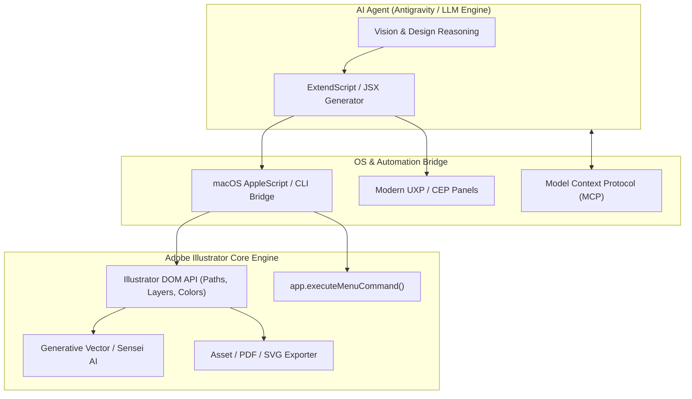
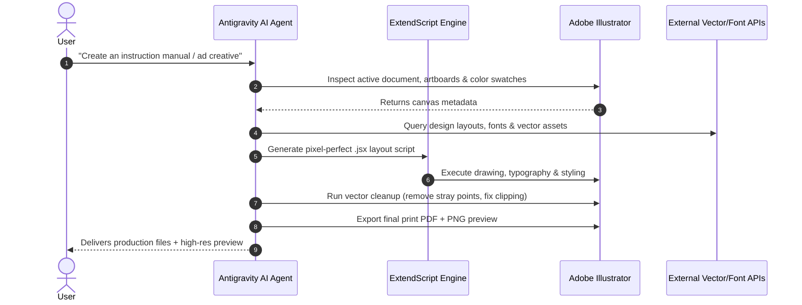
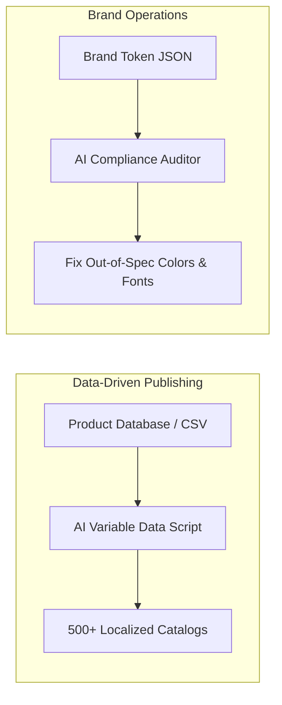

# How AI Controls & Automates Adobe Illustrator: Architecture & Integration Guide

Modern AI does not merely click buttons through computer vision; it controls Adobe Illustrator across four distinct operational layers: **Programmatic DOM Scripting**, **Headless Agent Orchestration**, **Native Generative AI Engines**, and **Automated Quality & Pre-Press Pipelines**.



---

## 1. Programmatic Control: ExtendScript & the Illustrator DOM

AI agents interface with Illustrator's entire menu system through **ExtendScript (JavaScript ES3/DOM API)** executed via AppleScript on macOS or VBScript on Windows.

### How AI Executes Illustrator Actions Programmatically
Instead of manually navigating the UI, an AI writes and evaluates `.jsx` scripts via a headless shell command:

```bash
osascript -e 'tell application "Adobe Illustrator" to do javascript "
    var doc = app.documents.add(DocumentColorSpace.RGB, 1920, 1080);
    var rect = doc.pathItems.rectangle(900, 300, 400, 200);
    var color = new RGBColor(); color.red = 255; color.green = 75; color.blue = 0;
    rect.fillColor = color;
    rect.stroked = false;
"'
```

### Accessing Every Menu Command via AI
Illustrator exposes internal string identifiers for nearly every menu bar command via `app.executeMenuCommand('string')`:

| Menu Category | ExtendScript Call | What the AI Accomplishes |
| :--- | :--- | :--- |
| **Object > Group** | `app.executeMenuCommand('group')` | Bundles selected items into a group. |
| **Object > Expand** | `app.executeMenuCommand('expandStyle')` | Flattens live strokes and dynamic appearances into raw paths. |
| **Path > Outline Stroke** | `app.executeMenuCommand('Live Outline Stroke')` | Converts weighted borders into filled vector paths. |
| **Select > Same** | `app.executeMenuCommand('Find Fill & Stroke menu item')` | Instantly isolates all artwork sharing exact color specs. |
| **Type > Outlines** | `app.executeMenuCommand('outline')` | Vectorizes all typography to avoid missing font errors on export. |
| **View > Outline** | `app.executeMenuCommand('preview')` | Switches between wireframe and GPU rendering. |

---

## 2. Autonomous Multi-Agent Workflows (Antigravity & MCP)

AI agents use specialized skills to perform complex commercial design tasks without human intervention:



### Active Production Capabilities
1. **Context-Aware Design Generation (`autonomous-ad-designer`)**:
   - Analyzes brief, products, and color harmony.
   - Generates grid systems, typographic scales, visual hierarchy, and CTA buttons directly on artboards.
2. **Automated Vector Repair (`vector-first-aid-illustrator`)**:
   - Identifies corrupted paths, 0-pixel stray points, unpainted paths, fragmented single-line text frames, and duplicate layers.
   - Runs non-destructive optimization scripts in under 2 seconds.
3. **Cross-Platform Bridge (`canva-illustrator-uploader`)**:
   - Extracts typography manifests from `.ai` files.
   - Converts vector layers and synchronizes them with cloud platforms like Canva via REST APIs.

---

## 3. Native Generative AI Engines Inside Illustrator

Illustrator has built-in generative intelligence powered by **Adobe Firefly** and **Adobe Sensei**:

### A. Text to Vector Graphic (Generative AI Panel)
- **Subject**: Generates isolated standalone vector objects (characters, icons, elements) with transparent backgrounds.
- **Scene**: Produces full-bleed, multi-layered vector compositions with automatic perspective.
- **Icon**: Creates simplified glyphs and flat branding marks.
- **Pattern**: Generates seamless tiling wallpaper and textile vector patterns that auto-save into the Swatches panel.

### B. Generative Recolor
- AI parses natural language prompts (e.g. *"Warm Autumn Sunset"* or *"Cyberpunk Neon 1980s"*) and recalculates vector color harmonies using color theory algorithms while maintaining tonal contrast.

### C. Retype (Font & Glyph Recognition)
- Uses computer vision to analyze rasterized or outlined text in placed images, identifying the exact or closest matching typeface from Adobe Fonts and converting it back into live editable typography.

### D. Mockup (Dynamic 3D Geometry Mapping)
- Detects surfaces, curvature, and lighting on raster photos (such as t-shirts, mugs, or packaging boxes) and dynamically wraps 2D vector logos around the 3D contours with realistic blending and shading.

---

## 4. High-Value Automation Use Cases for AI + Illustrator



1. **Massive Scale Variable Data Publishing**:
   - An AI agent takes an e-commerce catalog or spreadsheet and generates hundreds of unique packaging labels or banner sizes, auto-fitting text boxes and scaling artwork to prevent overflow.
2. **Autonomous Pre-Flight & Print Checking**:
   - Checks that all placed images meet minimum print resolution (300 DPI).
   - Verifies all fonts are outlined or packaged (`File > Package`).
   - Validates that bleed areas (typically 3mm or 0.125 in) are properly covered by background art.
   - Converts RGB blacks (`#000000`) into Rich Black (`C:60 M:40 Y:40 K:100`) for commercial offset presses.
3. **Asset Production Pipelines**:
   - Slices icons into 1x, 2x, 3x web assets, minifies SVG code, strips metadata, and commits directly to a code repository.
