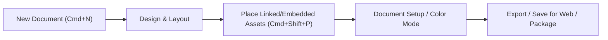
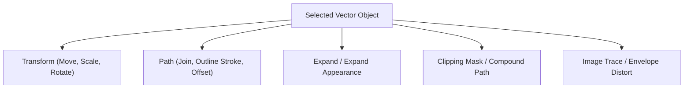
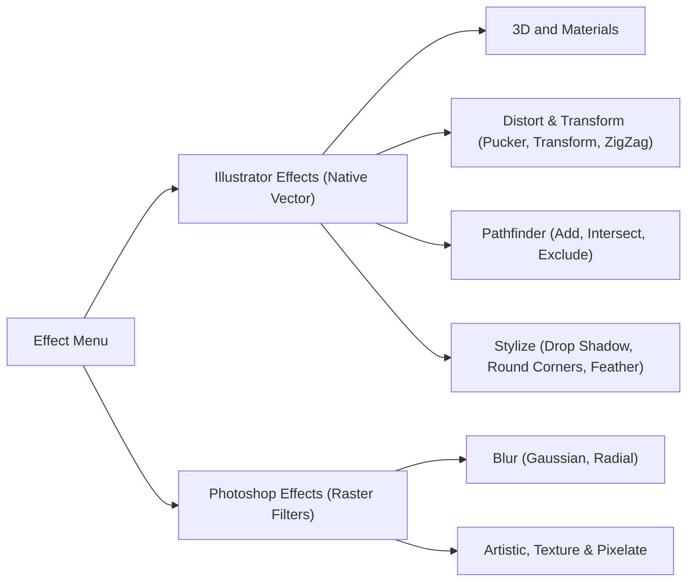

# Complete Master Reference: Adobe Illustrator Menu Bar & Workflows

This guide provides an exhaustive breakdown of every menu, panel system, command group, and standard shortcut in Adobe Illustrator on macOS.

---

## 1. Illustrator (Application Menu)

Controls app-level configuration, system integration, and global defaults.

| Menu Item | Shortcut | Function & Workflow |
| :--- | :--- | :--- |
| **About Illustrator** | — | Displays active version, build number, and installed plugin manifests. |
| **Preferences** | `Cmd + ,` | Critical settings hub: General, Selection & Anchor Display, Units (Points/Pixels/Millimeters), Guides & Grid, Performance (GPU acceleration), and Scratch Disks. |
| **Services / Hide / Quit** | `Cmd + Q` | Standard macOS process management. |

---

## 2. File Menu: Document Lifecycle & Asset Pipeline

Manages document creation, input/output pipelines, color definitions, and production delivery.

### Core Submenus & Commands
- **New / New from Template (`Cmd + N` / `Shift + Cmd + N`)**: Sets canvas intent (Print, Web, Video, Art & Illustration) with exact artboard dimensions, bleed margins, raster effects resolution (300 ppi vs 72 ppi), and color space (CMYK vs RGB).
- **Open / Open Recent / Browse in Bridge (`Cmd + O` / `Opt + Cmd + O`)**: Loads `.ai`, `.eps`, `.pdf`, `.svg`, and raster formats.
- **Save / Save As / Save a Copy (`Cmd + S` / `Shift + Cmd + S` / `Opt + Cmd + S`)**: Saves master vector document with PDF compatibility, compression, and embed profiles.
- **Place (`Shift + Cmd + P`)**: Imports raster imagery, PSDs, or other vector files. Offers **Link** (references disk file to minimize file size) or **Embed** (stores raster directly inside `.ai`).
- **Export**:
  - **Export for Screens (`Opt + Cmd + E`)**: Batch exports multiple artboards and asset assets into 1x, 2x, 3x PNG, SVG, PDF, or JPG simultaneously.
  - **Export As**: Exports full canvas or individual artboards to DWG, DXF, PSD, TIFF, SVG, or WebP.
  - **Save for Web (Legacy) (`Opt + Shift + Cmd + S`)**: Fine-tuned 2-up/4-up optimization for GIF, JPG, and PNG with perceptual color palettes.
- **Package (`Opt + Shift + Cmd + P`)**: Collects all linked images, placed graphics, fonts, and a summary report into a single folder for print or collaborator handoff.
- **Document Color Mode**: Flips the core rendering engine between **CMYK Color** (commercial printing) and **RGB Color** (digital screens).
- **Document Setup (`Opt + Cmd + P`)**: Changes bleed, grid transparency, and artboard units post-creation.

---

## 3. Edit Menu: Geometry Buffers & Global Modifications

Controls the clipboard, search, global recoloring, and editing environments.

- **Undo / Redo (`Cmd + Z` / `Shift + Cmd + Z`)**: Reversible history states.
- **Paste Variations**:
  - **Paste (`Cmd + V`)**: Places copied vectors in the center of the viewport.
  - **Paste in Front (`Cmd + F`)**: Positions pasted vector at the exact original X/Y coordinate immediately above the copied item in the layer stack.
  - **Paste in Back (`Cmd + B`)**: Positions pasted vector at the exact original X/Y coordinate immediately below the copied item.
  - **Paste in Place (`Shift + Cmd + V`)**: Pastes into exact coordinates across different artboards.
  - **Paste on All Artboards (`Opt + Shift + Cmd + V`)**: Stamps elements across every artboard at identical relative positions.
- **Edit Colors**:
  - **Recolor Artwork**: Dynamic color wheel and harmony engine to remap entire illustration palettes, convert CMYK to Grayscale, or reduce color count for screen-printing.
- **Presets & Profiles**:
  - **Keyboard Shortcuts (`Opt + Shift + Cmd + K`)**: Remap tools and menu shortcuts.
  - **Color Settings (`Shift + Cmd + K`)**: Set RGB working spaces (sRGB, Adobe RGB 1998, Display P3) and CMYK ICC profiles (U.S. Web Coated SWOP, Coated FOGRA39).

---

## 4. Object Menu: Vector Construction & Transformations

The operational core for constructing, transforming, grouping, and altering paths.

### Essential Commands
- **Transform**: Move (`Shift + Cmd + M`), Rotate, Reflect, Scale, Shear, and **Transform Each** (`Opt + Shift + Cmd + D` — transforms multiple selected objects around their individual centerpoints).
- **Arrange**: Stacking order adjustments (`Cmd + ]` Bring Forward, `Cmd + [` Send Backward, `Shift + Cmd + ]` Bring to Front, `Shift + Cmd + [` Send to Back).
- **Group (`Cmd + G`) / Ungroup (`Shift + Cmd + G`)**: Bundles items into logical units without flattening.
- **Lock (`Cmd + 2`) / Unlock All (`Opt + Cmd + 2`)**: Prevents accidental selection of background or reference paths.
- **Hide (`Cmd + 3`) / Show All (`Opt + Cmd + 3`)**: Temporarily removes clutter.
- **Expand & Expand Appearance**:
  - **Expand Appearance**: Bakes dynamic live effects (strokes, drop shadows, 3D extrusions, warp bends) into permanent vector geometry.
  - **Expand**: Converts strokes with fill/stroke definitions or gradients into standalone closed filled paths.
- **Path Submenu**:
  - **Join (`Cmd + J`)**: Bridges two open anchor points with a path segment.
  - **Outline Stroke**: Converts an open line path with stroke weight into a closed perimeter shape.
  - **Offset Path**: Generates expanded or contracted parallel vector contours (essential for badges, cut-lines, and sticker borders).
  - **Simplify**: Reduces anchor point count while maintaining path curvature tolerances.
- **Shape**: Converts custom shapes into Live Shapes (rectangles with live rounded corners, polygons, ellipses).
- **Pattern & Repeat**:
  - **Pattern > Make**: Opens the tile pattern editing workspace.
  - **Repeat**: Radial, Grid, or Mirror repeat engines for symmetric design.
- **Clipping Mask (`Cmd + 7` / Release `Opt + Cmd + 7`)**: Uses the topmost vector path as a window to clip visible regions of objects or placed images underneath.
- **Compound Path (`Cmd + 8` / Release `Opt + Shift + Cmd + 8`)**: Cuts holes out of overlapping vector shapes (e.g. the counter space in the letter "O" or donut shapes).
- **Image Trace**: Converts placed pixel raster artwork into editable vector paths with presets for 16-color, silhouettes, and technical drawings.

---

## 5. Type Menu: Typographic Engine & OpenType Controls

Directs text layout, font rendering, character encoding, and path typography.

- **Add Fonts / Find / Replace Font**: Resolves missing fonts across client documents.
- **Glyphs**: Interactive character matrix to access alternate ligatures, swashes, accents, and symbols.
- **Convert to Area Type / Point Type**: Toggles between text in fixed bounding boxes (word-wrapping) and unconstrained line text.
- **Type on a Path**: Wraps text along vector curves and bezier splines with skew and alignment controls.
- **Create Outlines (`Shift + Cmd + O`)**: Converts live editable fonts into raw vector bezier paths (`PathItem`), removing font dependency for print production.
- **Change Case**: Uppercase, Lowercase, Title Case, Sentence Case.
- **Smart Punctuation**: Auto-replaces hyphens with en/em-dashes, plain quotes with smart curly quotes, and ellipses.

---

## 6. Select Menu: Precision Targeting & Bulk Isolation

Allows targeting vector nodes and artwork across complex layouts without hunting through layers.

- **All (`Cmd + A`) / Deselect (`Shift + Cmd + A`) / Reselect (`Shift + Cmd + D`) / Inverse**: Basic selection control.
- **Same**: Massively productive selection filter that selects all items sharing:
  - **Fill Color**, **Stroke Color**, or **Fill & Stroke**
  - **Stroke Weight** (replaces line styles document-wide)
  - **Appearance** or **Graphic Style**
  - **Blending Mode** or **Opacity**
- **Object**: Selects technical path categories:
  - **Stray Points** (zero-length unpainted debris)
  - **Clipping Masks**
  - **Text Objects**
- **Save Selection**: Stores a custom group selection as a named set for quick reselection later.

---

## 7. Effect Menu: Live Dynamic Styling Engine

Applies non-destructive appearances. Items in this menu update live and can be edited or removed at any time via the **Appearance Panel**.

> [!IMPORTANT]
> - **Illustrator Effects** stay resolution-independent vectors.
> - **Photoshop Effects** rasterize dynamically at the DPI defined in `Effect > Document Raster Effects Settings` (e.g. 300 ppi for print, 72 ppi for web).

---

## 8. View Menu: Canvas Rendering & Snapping Environment

Controls what is displayed, preview fidelity, grid snapping, and screen guides.

- **Preview Modes**:
  - **Outline View (`Cmd + Y`)**: Strips away all fills, strokes, and effects to show pure wireframe bezier lines. Crucial for pinpoint anchor alignment.
  - **GPU Preview / CPU Preview (`Cmd + E`)**: Toggles hardware acceleration.
  - **Overprint Preview (`Opt + Shift + Cmd + Y`)**: Accurately simulates how spot inks and CMYK plates blend when pressed onto paper.
  - **Pixel Preview (`Opt + Cmd + Y`)**: Previews how vectors will anti-alias into square pixels at current screen scale.
- **Rulers (`Cmd + R`)**: Drags coordinate guides onto artboards.
- **Guides**:
  - **Make Guides (`Cmd + 5`)**: Turns any vector path into an invisible snapping guide.
  - **Lock Guides (`Opt + Cmd + ;`)** / **Clear Guides**.
- **Smart Guides (`Cmd + U`)**: Dynamic green/magenta alignment overlays that display snapping angles, intersections, and equidistant spacing hints.
- **Snapping**: Snap to Point, Snap to Grid, Snap to Pixel, and Snap to Glyph.

---

## 9. Window Menu: Panel Ecosystem & Workspaces

The hub that opens, docks, and arranges all individual UI panels.

### Workspace Presets (`Window > Workspace`)
- **Essentials / Essentials Classic**: Standard workspace docks for layout.
- **Typography**: Opens Character, Paragraph, OpenType, Glyphs.
- **Painting / Web**: Arranges Brushes, Color, Swatches, and Asset Export.

### Key Functional Panels

| Panel Name | Purpose | Key Tools Inside |
| :--- | :--- | :--- |
| **Properties** | Contextual single-pane hub | Displays relevant controls based on current selection (dimensions, align, appearance, quick actions). |
| **Layers (`F7`)** | Hierarchical scene tree | Organizes artwork across sublayers, groups, clipping paths, visibility eyes, and lock toggles. |
| **Align (`Shift + F7`)** | Spacing & position | Align to Selection, Align to Key Object, Align to Artboard; Distribute Objects and Spacing. |
| **Pathfinder (`Shift + Cmd + F9`)** | Boolean geometry | **Shape Modes** (Unite, Minus Front, Intersect, Exclude) and **Pathfinders** (Divide, Trim, Merge). |
| **Appearance (`Shift + F6`)** | Layered styling | Add multiple Fills, multiple Strokes, Opacity, and individual Live Effects to a single object. |
| **Color (`F6`) / Swatches** | Color formulation | Sliders (CMYK, RGB, HSB), Global Swatches, Spot Colors (Pantone), and Gradients. |
| **Stroke (`Cmd + F10`)** | Outline formatting | Stroke Weight, Cap styles (Butt, Round, Projecting), Corners (Miter, Round, Bevel), Dashed Lines, and Arrowheads. |
| **Transform (`Shift + F8`)** | Exact numeric positioning | X/Y coordinates, Width/Height dimensions, Rotation angle, Shear, and Constrain Proportions. |
| **Image Trace** | Raster-to-vector engine | Threshold, Paths, Corners, Noise, Method (Abutting vs Overlapping), Ignore White. |
| **Asset Export** | Production asset generator | Drag-and-drop bucket to batch export UI icons and assets into multiple densities. |

---

## 10. Help Menu: Search & Command Palette

- **Search field**: Type any tool or menu name (e.g. "Offset Path"), and macOS automatically expands the corresponding menu and points an animated blue arrow directly at the command.
- **Tutorials & Release Notes**: Direct access to Adobe Learn resources.
