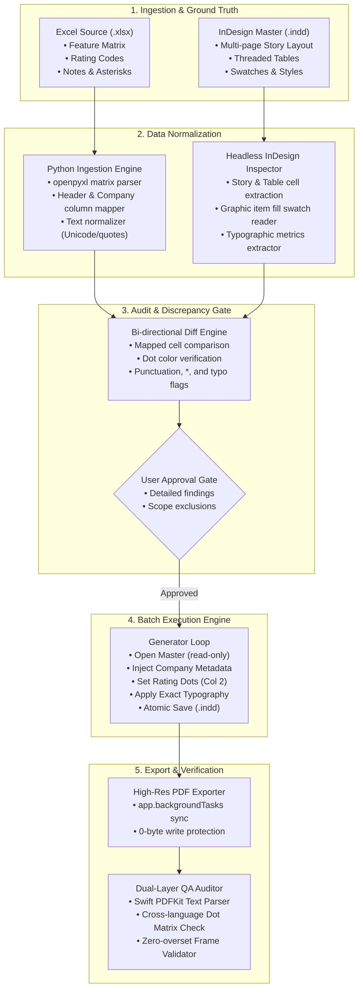

# Architectural Blueprint: Excel-to-InDesign Batch Matrix Publisher Skill
## Design Specification for an Automated Publishing & Quality-Assurance Skill

---

### Executive Overview

This document specifies the architecture, data flow, ExtendScript engine patterns, and automated verification loops used to process complex, multi-language InDesign matrix documents from an Excel single source of truth (`.xlsx`).

You can package this workflow into a reusable Antigravity/GSD skill (e.g., `xlsx-indesign-matrix-publisher`) defined by a standard `SKILL.md` and supporting Python / ExtendScript helper scripts.



---

### 1. Architectural Phases

The workflow is strictly governed by a **Human-in-the-Loop Protocol**:

```
[Phase 1: Ingestion & Normalization]
               │
               ▼
[Phase 2: Headless InDesign Audit]
               │
               ▼
[Phase 3: Mandatory Overview & Approval Gate] ◄── MANDATORY: Tell user first!
               │ (Wait for User Approval)
               ▼
[Phase 4: Batch Generation & Typography Alignment]
               │
               ▼
[Phase 5: Synchronous PDF Export & Validation]
```

> [!IMPORTANT]
> **MANDATORY PRE-EXECUTION RULE**:
> Before starting any document mutation, batch processing, or PDF export, you **MUST** provide the user with a comprehensive overview text outlining:
> 1. Exactly what actions will be performed.
> 2. What discrepancies or changes were detected in the master/template files.
> 3. What specific values, colors, styles, or text will be updated.
> 
> **NEVER touch documents on disk or start generation until the user explicitly approves this overview.**

---

### Phase 1: Ingestion & Normalization (The Python Layer)

#### 1. Why Python for Ingestion?
ExtendScript (Adobe's internal JavaScript engine) is based on **ECMAScript 3 (1999)**. It lacks modern regular expressions, JSON streaming, and UTF-8 string decoders. Python 3 provides robust Unicode normalization, native `.xlsx` handling via `openpyxl`, and JSON serialization.

#### 2. Key Responsibilities:
1. **Matrix Reading**:
   * Read the sheet rows and extract headers (Row 9 in AFKL: Company names in columns F through AA).
   * Map status codes to InDesign swatch names:
     * `3` ➔ `"Green RGB"` (Available / Oui)
     * `2` ➔ `"Orange RGB"` (Work in progress / En cours)
     * `1`, `x`, empty ➔ `"Grey RGB"` (Unavailable / Non)
2. **InDesign-to-Excel Row Mapping (`indesign_to_excel_map.json`)**:
   * Build a declarative dictionary mapping InDesign table rows (`0` to `N`) to their corresponding Excel row indices.
   * Strip formatting artifacts, non-breaking spaces (`\u00A0`), and typographic curly quotes before comparison.

---

### Phase 2: Headless InDesign Inspection (The ExtendScript Layer)

#### 1. Inspecting Tables & Color Dots
In InDesign, table cells do not store "dot color" as text. A cell contains an embedded graphic page item (an oval or rectangle) with a `fillColor`.

```javascript
// Reading cell rating dot color safely:
function getCellDotColor(cell) {
    if (cell.allPageItems.length > 0) {
        try {
            return cell.allPageItems[0].fillColor.name;
        } catch(e) {
            return "ERR";
        }
    }
    return "NONE";
}
```

#### 2. Extracting Typographic Specifications
To avoid font distortion during text replacement, the inspector extracts:
* `appliedFont.name` (Family + Weight string, e.g. `"Montserrat\tRegular"`)
* `pointSize` (e.g. `5.5`)
* `leading` (e.g. `Leading.AUTO`, `5`, or `8`)
* `kerningMethod` (`"Metrics"` vs `"Optical"`)
* `tracking` (e.g. `0`)
* `justification` (`Justification.LEFT_ALIGN`)

---

### Phase 3: The Mandatory Overview & User Approval Gate

Never silently alter a master file or batch-generate documents without presenting the audit findings first.

#### Mandatory Pre-Execution Overview Requirement:
Before running batch generation, typography updates, or exports, the agent must output a structured **Pre-Execution Overview** detailing:
1. **Audit Summary**: Detected changes in the master files or discrepancies between Excel and InDesign.
2. **Planned Scope of Changes**:
   * Text & Footnote changes (e.g. frequency, asterisks, definitions).
   * Typographic specs to be applied (Font family, weight, point size, leading, tracking, kerning).
   * Rating dots to be mutated per company.
3. **Execution Plan**: Sequence of operations (master update ➔ batch propagation ➔ PDF export ➔ verification).
4. **Explicit Call for Approval**: Asking the user to confirm before proceeding.

#### The 3-Tier Classification Matrix:
1. **Critical Differences**: Changed feature names, missing categories, mismatched rating dots.
2. **Metadata & Asterisks**: Missing `*` in feature names (e.g., `SAF*` vs `SAF`), updated footnotes, dates (`November 2026`).
3. **Typographic Anomalies**: Wrong font weight (e.g., `Light` vs `Regular`), oversized text (e.g., `7.0 pt` vs `5.5 pt`), misaligned leading.

---

### Phase 4: Batch Document Generation & Typographic Enforcement

#### 1. Why Template Cloning is Faster and Safer:
Rather than building 23 documents from scratch, open the verified master file (`Aaron Group.indd`), clone it in memory, update only the target variables, and save with the new file name.

#### 2. Target Company Mutations (Isolated & Contained):
* **Cover Page (Page 1):** Update title text frame with the company name.
* **Table 0 Column 2 (Header):** Update header cell to company name.
* **Table 0 Column 2 (Rating Dots):**
  ```javascript
  // Set fill swatch of existing oval
  if (cell.allPageItems.length > 0) {
      cell.allPageItems[0].fillColor = doc.swatches.itemByName(targetSwatchName);
  }
  ```
* **Table Footers:** Apply exact typographic properties to avoid inheriting legacy styling:
  ```javascript
  tf.texts[0].appliedFont = app.fonts.itemByName("Montserrat\tRegular");
  tf.texts[0].pointSize = 5.5;
  tf.texts[0].kerningMethod = "Metrics";
  tf.texts[0].tracking = 0;
  tf.paragraphs[0].leading = Leading.AUTO;
  if (tf.paragraphs.length >= 3) {
      tf.paragraphs[1].leading = 5;
      tf.paragraphs[2].leading = 8;
  }
  ```

---

### Phase 5: PDF Export & Multi-Layer QA

#### 1. The Background Task Problem & Solution:
In modern InDesign (CC 2020+), PDF export runs asynchronously in a worker thread (`app.backgroundTasks`). If the script calls `doc.close()` while the export thread is writing, InDesign generates an empty (0-byte) PDF or crashes.

**The Mandatory Synchronization Loop:**
```javascript
doc.exportFile(ExportFormat.PDF_TYPE, pdfFile, false, preset);

var waitLoops = 0;
while (app.backgroundTasks.length > 0 && waitLoops < 120) {
    $.sleep(500);
    waitLoops++;
}
```

#### 2. AppleScript Timeout Shield:
Default AppleScript timeout is 120 seconds. Batch exporting 23 files can take 2–3 minutes. Always wrap the invocation:
```applescript
with timeout of 600 seconds
    tell application "Adobe InDesign 2026"
        do script (POSIX file "/path/to/script.jsx") language javascript
    end tell
end timeout
```

#### 3. Post-Export Headless Validation:
* **Disk Integrity**: Verify file count ($23/23$) and file size ($>1.5\text{ MB}$).
* **Text Extraction via Swift PDFKit**:
  Extract text programmatically from the PDF to verify that rendered text matches the master without opening a GUI.
* **Cross-Language Validation**:
  Compare all $1,748$ status dots between English and French to guarantee $100\%$ parity across languages.

---

### Reusable Skill Architecture (`SKILL.md` Design)

To package this into an autonomous skill, define the following folder structure:

```
~/.gemini/antigravity/skills/indesign-matrix-publisher/
├── SKILL.md                          # Main prompt & orchestrator
├── scripts/
│   ├── parse_excel_matrix.py         # Extracts Excel rows and column ratings
│   ├── inspect_indesign_doc.jsx      # Dumps InDesign doc tables, frames, styles
│   ├── diff_matrix.py                # Cross-checks Excel vs InDesign
│   ├── batch_generate.jsx            # InDesign batch generator & styler
│   ├── export_pdfs.jsx               # Background-synchronized PDF exporter
│   └── verify_pdfs.swift             # Swift PDFKit validation script
└── references/
    ├── indesign_es3_gotchas.md       # ExtendScript constraints & polyfills
    └── typography_rules.md           # Font size, leading, tracking contracts
```

#### Complete `SKILL.md` Specification Template:

```markdown
---
name: indesign-matrix-publisher
description: Batch generates and audits multi-document InDesign matrix publications from an Excel source of truth. Enforces mandatory pre-execution overview before making changes.
---

# InDesign Matrix Publisher Skill

Use this skill whenever generating, auditing, or updating batch InDesign documents from an Excel spreadsheet matrix (.xlsx).

## Core Rules & Execution Flow

### 1. Mandatory Pre-Execution Overview Rule
**STRICT GATING PROTOCOL:**
Before modifying any InDesign file on disk, running batch generation, or exporting PDFs:
1. Run inspection on the Excel matrix and the InDesign template/master files.
2. Produce a human-readable **Pre-Execution Overview** detailing:
   - Discrepancies found (text differences, rating dot changes, missing asterisks, metadata).
   - Planned typography settings (Font family, weight, pointSize, leading, kerning/tracking).
   - Planned batch operations (files to update, paths, export settings).
3. **STOP AND WAIT FOR USER APPROVAL.** Do not proceed until the user explicitly confirms.

### 2. Execution Workflow (Upon Approval)
1. **Master Alignment**: Apply approved fixes to master document and save.
2. **Batch Propagation**: Clone master for each company, updating only company name, rating dots, and styled footers.
3. **PDF Export**: Export with `[High Quality Print]` and synchronize with `app.backgroundTasks` to avoid 0-byte files.
4. **Validation**: Verify PDF file counts, sizes, and extract rendered text using Swift PDFKit.
```

